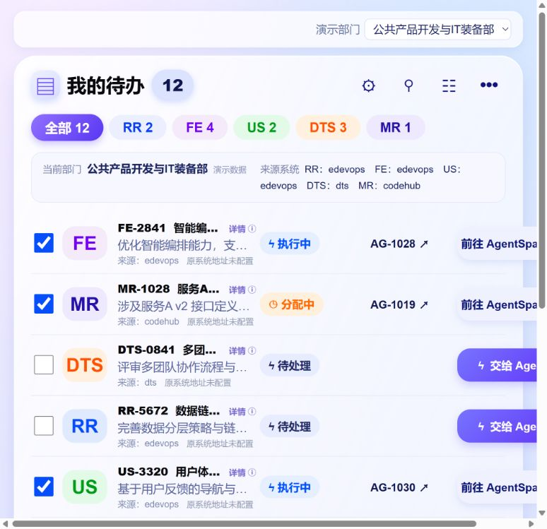
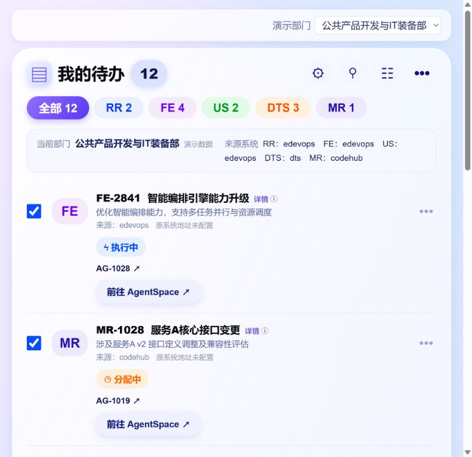
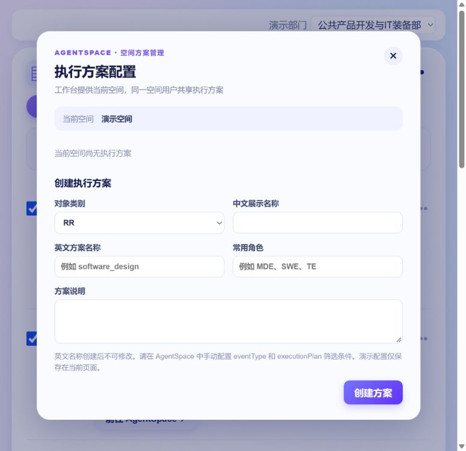

# CL-004：调测问题即时修复与窄视口布局

| 项目 | 内容 |
|---|---|
| 日期 | 2026-11-24 |
| 关联需求 | [REQ-001](../requirements/REQ-001-todo-agent-widget.md) |
| 涉及 Widget | 我的待办、Agent 任务追踪 |

> 历史过程记录：该轮布局策略已被 [CL-005](CL-005-responsive-strategy.md) 替代，当前页面以 design 目录为准。

## 本轮页面变更

**修复已发现的横向溢出，并明确调测发现问题必须立即修复、复测。**

| 位置 | 修复前 | 修复后 |
|---|---|---|
| 窄视口待办列表 | 固定列宽挤出页面，操作按钮被截断 | 信息、状态、任务编号和按钮分行排列 |
| 任务追踪 | 双栏内容可能挤压 | 较窄视口改为上下排列 |
| 图标按钮 | 文字符号对齐依赖字体基线 | 按钮采用统一居中布局 |
| 详情和方案管理按钮 | 空间不足时可能挤压 | 允许按钮组换行 |

体验：通过本地 HTTP 打开页面，在窄视口查看待办及其操作，打开设置弹窗检查表单和创建按钮。

## 明确的规则

调测发现溢出、图标错位、按钮排布不合理、遮挡或操作不可见时，立即修复并复测；不能只记录问题后交付。修复同步更新规格和本轮截图。

## 实际截图

公共产品开发与IT装备部，内置浏览器窄视口；修复后 DOM 报告视口宽 790 CSS 像素。

修复前，右侧按钮被截断：

修复后，列表按可用宽度重排：

设置弹窗复测：

## 同步与验证

更新 [AGENTS.md](../../AGENTS.md)、[页面样式](../../demo/styles.css)、[待办规格](../requirements/REQ-001-todo-agent-widget.md)。

HTTP 实际渲染截图已检查；页面宽度检测为 scrollWidth 775、小于 innerWidth 790，无页面横向溢出；设置入口正常打开。此记录针对本轮布局与入口复测，不表示全部业务流程均已验收。尚未提交或推送。
