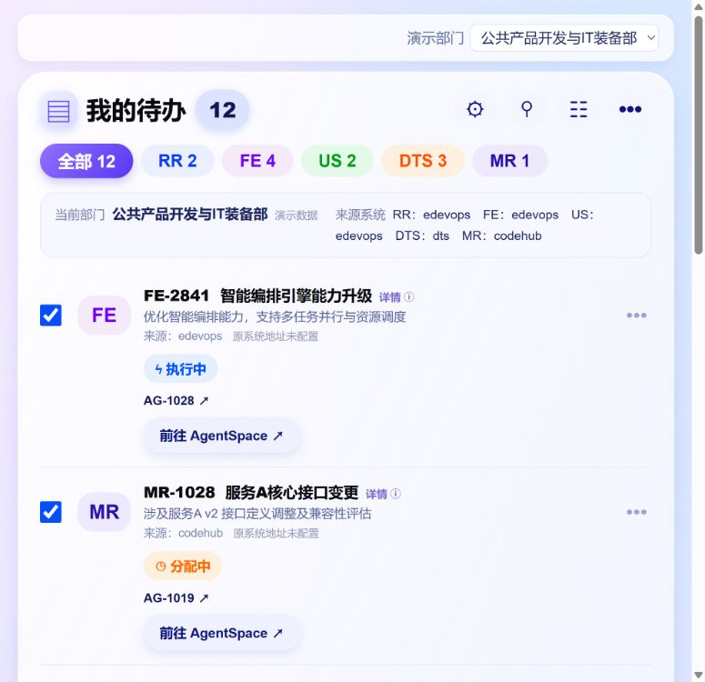
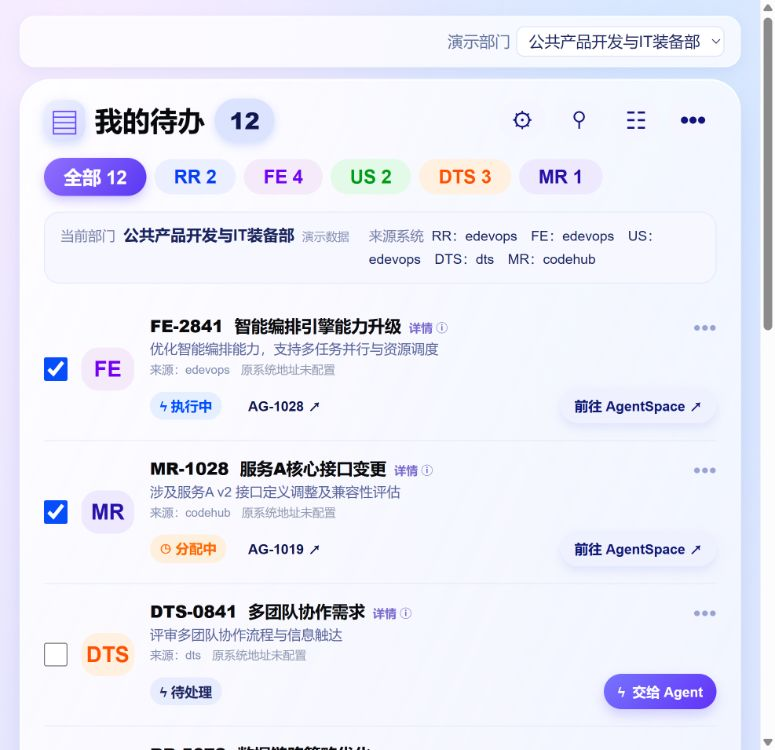
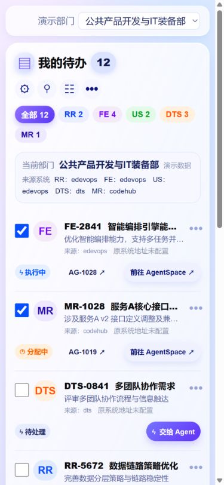
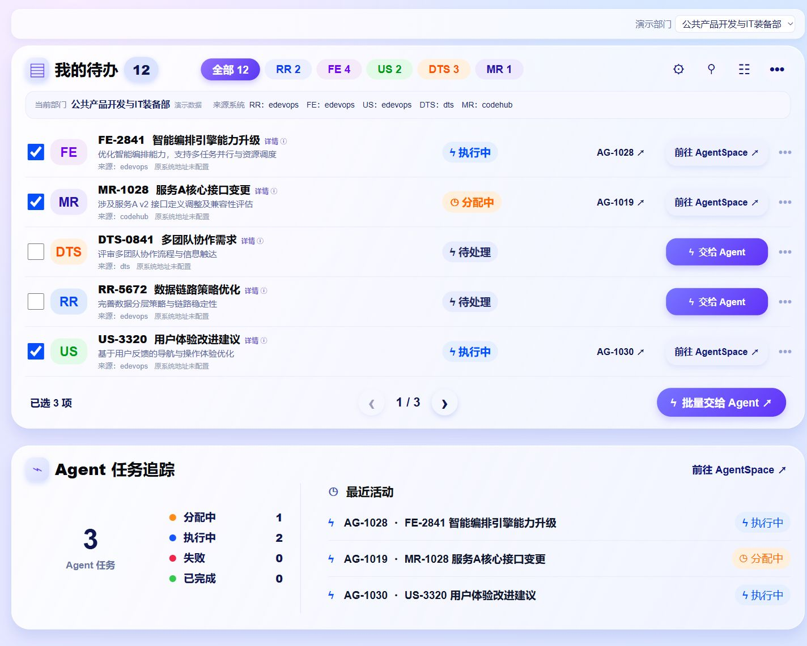

# CL-005：重新设计自适应策略

日期：2026-11-24。关联 [REQ-001](../requirements/REQ-001-todo-agent-widget.md)。

## 本轮页面变更

**替换上一轮逐字段换行的策略，按屏幕空间组织信息和操作。**

| 区域 | 上一轮 | 本轮 |
|---|---|---|
| 中等宽度待办 | 状态、任务编号、按钮逐行堆叠 | 摘要在上，状态、编号和操作集中在下 |
| 手机待办 | 每行高度大、操作分散 | 摘要与紧凑操作区，两层组织 |
| 宽屏待办 | 固定最小列宽 | 弹性摘要列与固定操作区，保留列式浏览 |

## 已明确的验收规则

发现机械换行、留白过多、图标错位和操作分散时，调整自适应策略；不能把没有横向溢出视为全部通过。该规则已写入 [AGENTS.md](../../AGENTS.md)。

## 实际截图对照

同为公共产品开发与IT装备部。上一轮 790px 左右视口，信息被过度拆散：

本轮中等视口（DOM 报告 790 CSS px）：

手机视口（390 CSS px）：

桌面视口（1440 CSS px，完整页面截图）：

## 验证与交付

三个尺寸均已通过本机 HTTP 实际渲染及截图检查，页面宽度检测无横向溢出；中等视口工作项高度约 145.5 CSS px，替代上一轮过度堆叠。临时视口覆盖已恢复。当前记录只覆盖响应式布局，不代表所有业务操作已全量验收。

同步 [页面样式](../../demo/styles.css)、REQ-001 与仓库约定。尚未提交或推送。
