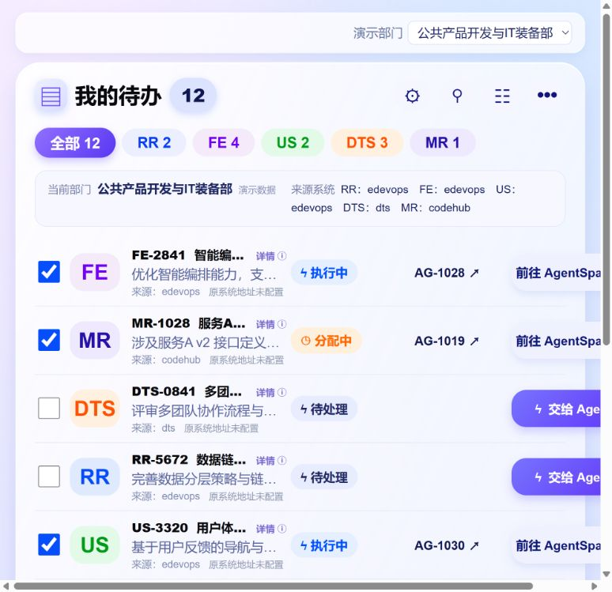
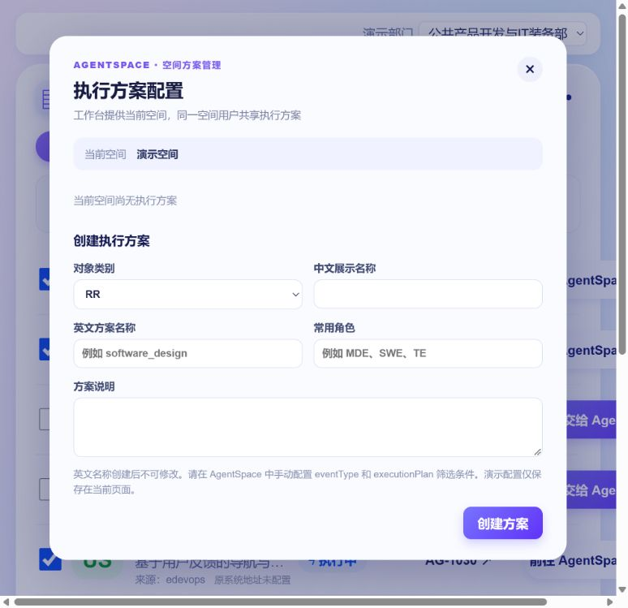

# CL-003：本地 HTTP 调测与截图

| 项目 | 内容 |
|---|---|
| 日期 | 2026-11-24 |
| 涉及 Widget | 我的待办 |
| 关联文档 | [功能澄清汇总](widget-feature-clarification.md)、[AGENTS.md](../../AGENTS.md) |

## 本轮页面变更

**无业务界面修改。本轮将调测入口改为本地 HTTP，并首次取得真实页面截图。**

| 项目 | 之前 | 本轮结果 |
|---|---|---|
| 访问方式 | file 协议被浏览器策略拒绝 | 本机 HTTP 成功访问 |
| 页面证据 | 尚无实际截图 | 保存首页和执行方案配置弹窗截图 |
| 后续调测 | 直接打开本地文件 | 默认启动仅提供 demo 目录的回环 HTTP 服务 |

## 体验路径及规则

从仓库根目录执行 `python -m http.server 8000 --bind 127.0.0.1 --directory demo`，访问 `http://127.0.0.1:8000/`。打开“我的待办”中的设置图标，可查看执行方案配置。已有服务时先检查和复用。

## 实际页面截图

当前部门为公共产品开发与IT装备部，使用内置浏览器当前窄视口。没有取得历史前态截图；下图只记录当前实际页面。

## 验证结果与限制

HTTP 返回 200；页面实际加载；组件内设置入口打开并关闭成功；配置选项为 RR、FE、US、DTS、MR。窄视口下首页列表存在横向溢出，宽屏与响应式布局尚未完整验证。创建、编辑、启停、删除及实际源系统跳转没有在本轮全流程验收。

## 同步文件与交付

更新 AGENTS.md、工具说明、功能澄清汇总及澄清索引。新增截图位于 `assets/screenshots/CL-003/`。尚未提交或推送。
