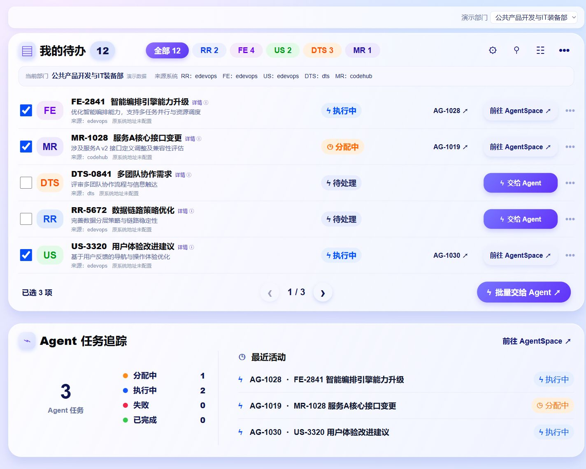
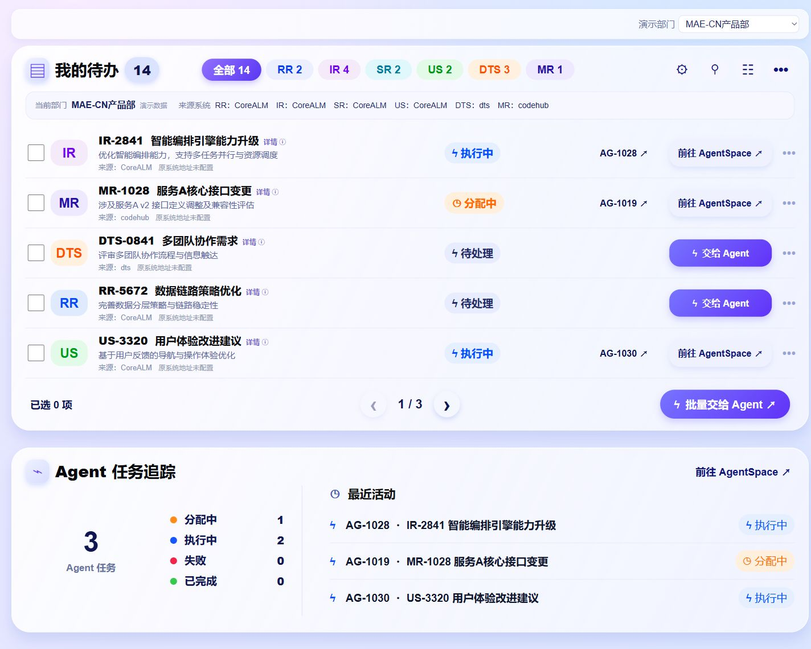
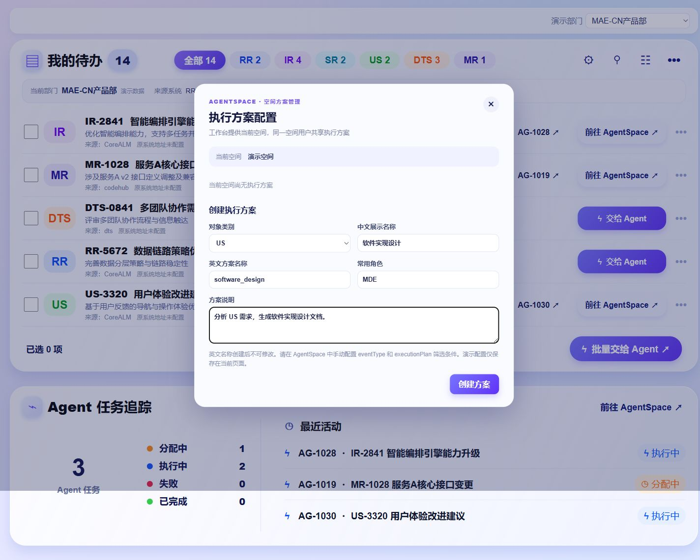
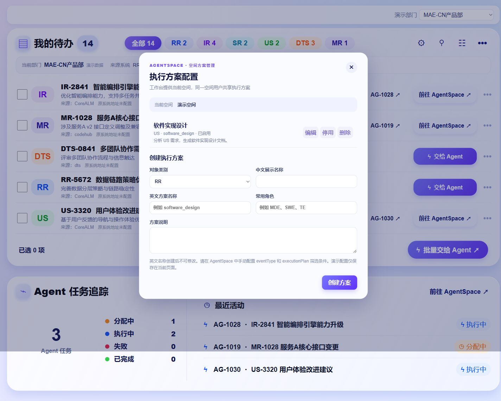
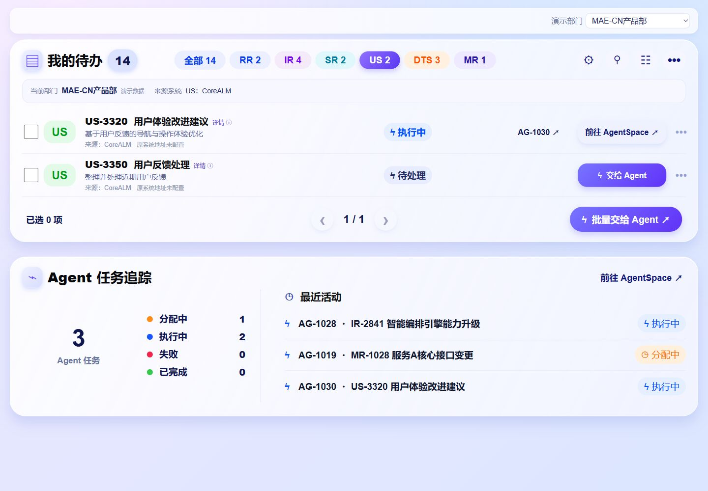
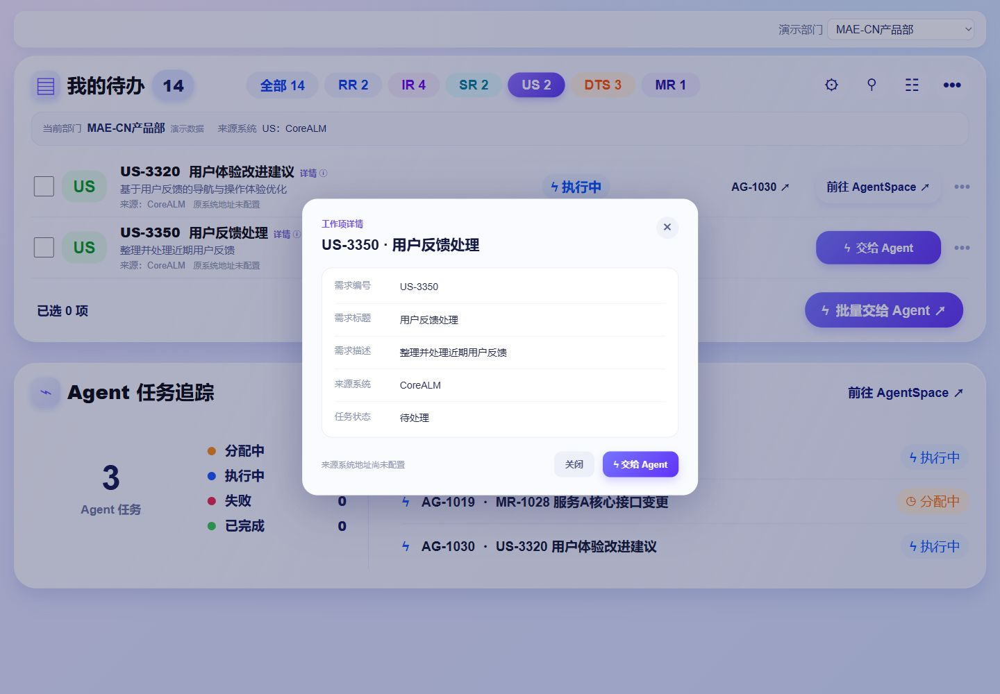
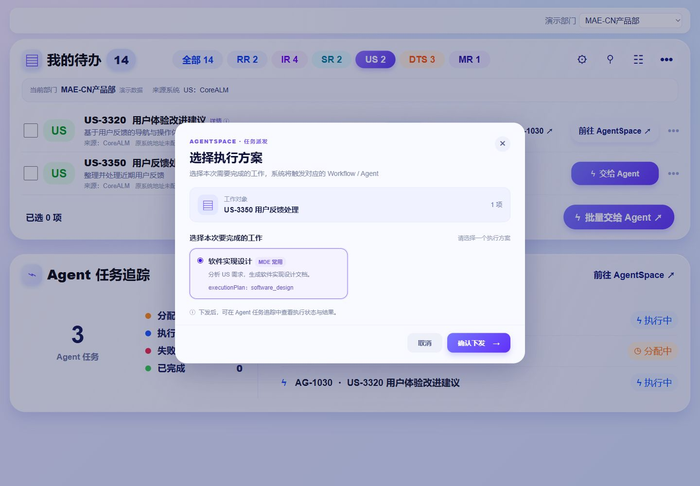
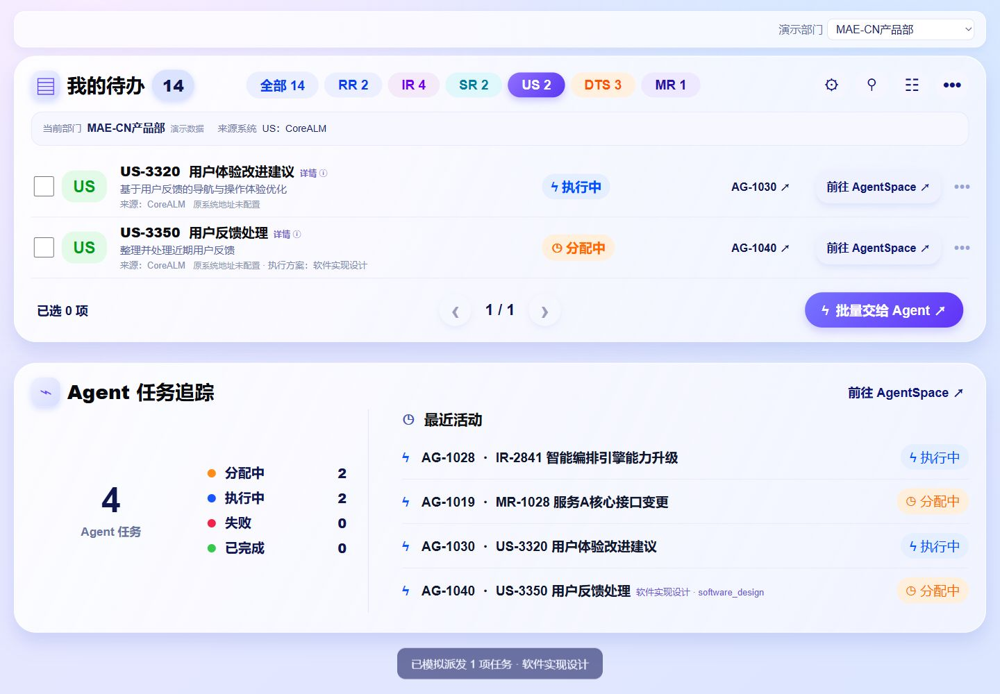
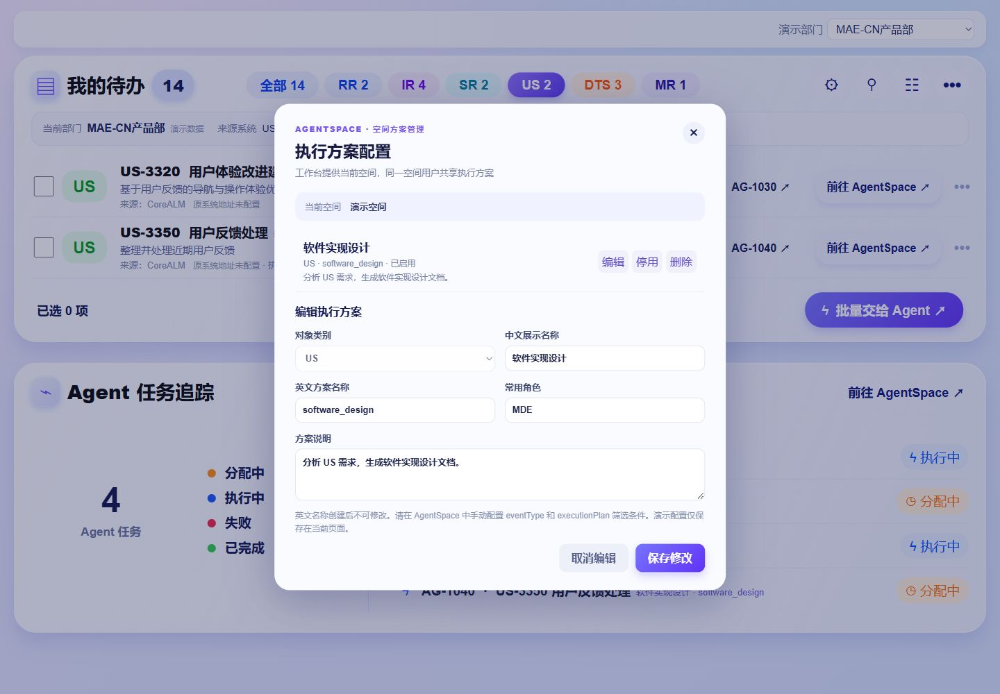
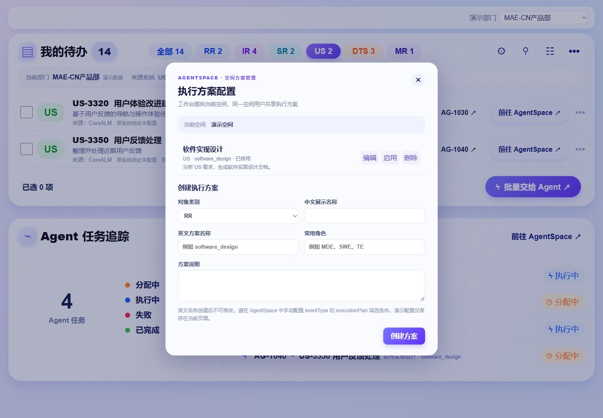

# CL-006：本轮关键交互图解

日期：2026-11-24。关联 [完整功能设计](widget-feature-clarification.md)、[REQ-001](../requirements/REQ-001-todo-agent-widget.md)、[REQ-003](../requirements/REQ-003-custom-execution-plan.md)。

## 本轮页面变更

**刷新本轮完整设计文档并补齐实际交互截图；修复截图走查发现的 MAE-CN 总数徽标错误。**

| 位置 | 之前 | 本轮 |
|---|---|---|
| MAE-CN 标题徽标 | 固定 12，与全部 14 不一致 | 根据当前部门数据计算，显示 14 |
| 设计文档 | 主要为功能文字和首页截图 | 补齐创建、管理、编辑、停用、详情、选择方案、下发结果 |

入口：[本地 HTTP demo](http://127.0.0.1:8000/)。截图均为实际页面，1440 × 1000 CSS px 视口；完整页面截图高度可超过视口。方案及下发均为本地模拟。

## 1. 部门差异

画布顶部模拟部门；业务设置仍位于 Widget 内。装备部显示 FE，MAE-CN 显示 IR 和 SR。

## 2. 创建空间执行方案

从待办设置图标进入配置，当前空间为演示空间。MAE-CN 演示选项为 RR、IR、SR、US、DTS、MR。示例填写 US、软件实现设计、software_design、MDE 和说明；不填写 Workflow / Agent 实体。

创建后，管理列表显示启用状态和编辑、停用、删除入口。

## 3. 筛选与详情内下发

选择 US 后只展示 US 的来源 CoreALM；点击 US-3350 标题打开详情。

详情展示编号、标题、描述、来源和状态，可直接点击交给 Agent；原系统地址未配置时如实提示。

## 4. 选择方案与任务回显

点击详情内交给 Agent，进入选择方案弹窗；未选择时确认按钮禁用，选择后可确认。显示英文标识 executionPlan，不直接调用 Workflow / Agent。

确认后，US-3350 显示分配中，追踪任务总数变为 4，新增任务展示中文方案名及 software_design。

## 5. 编辑与停用

编辑时，英文方案名称和类别不可修改；截图记录锁定状态。

停用后显示已停用及启用操作。已下发任务继续保留方案信息。

## 验证与交付

本轮实际验证：部门切换、创建方案、类别筛选、打开详情、详情内下发、方案选择、确认后状态及方案回显、编辑标识锁定、停用状态。语法和文档链接检查通过。

响应式布局检查及前后截图见 [CL-005](CL-005-responsive-strategy.md)。本轮未验证真实来源跳转、跨用户权限、后端事件发送、删除确认或全部异常分支；不将本地模拟表述为实际集成。

同步完整功能设计、REQ-001、页面脚本与脚本资源版本。临时视口覆盖已恢复。尚未提交或推送。
