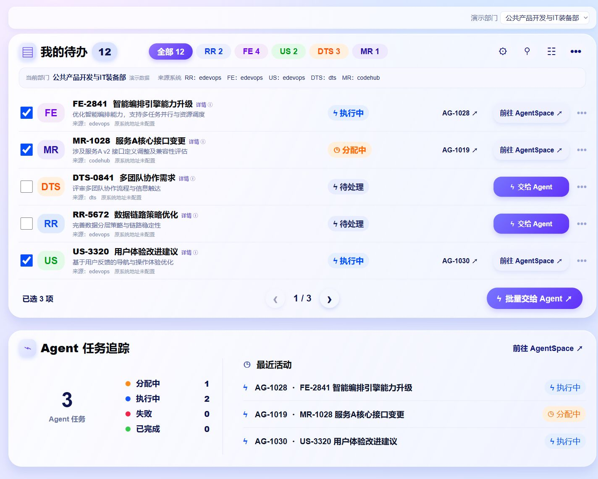
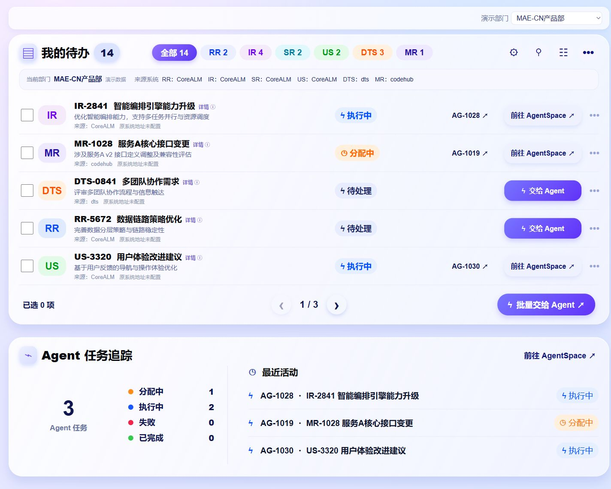
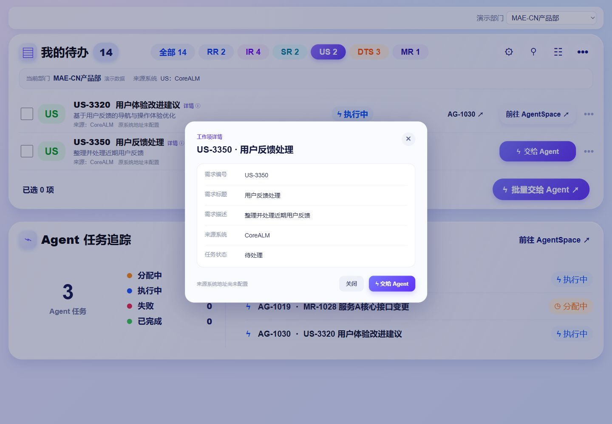
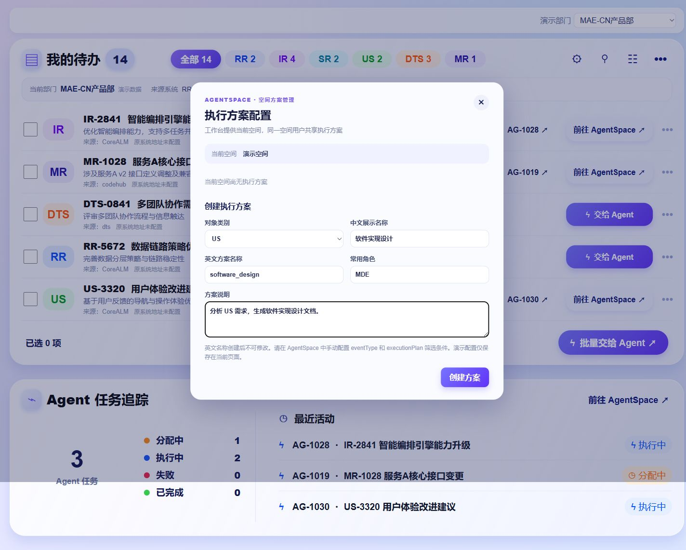
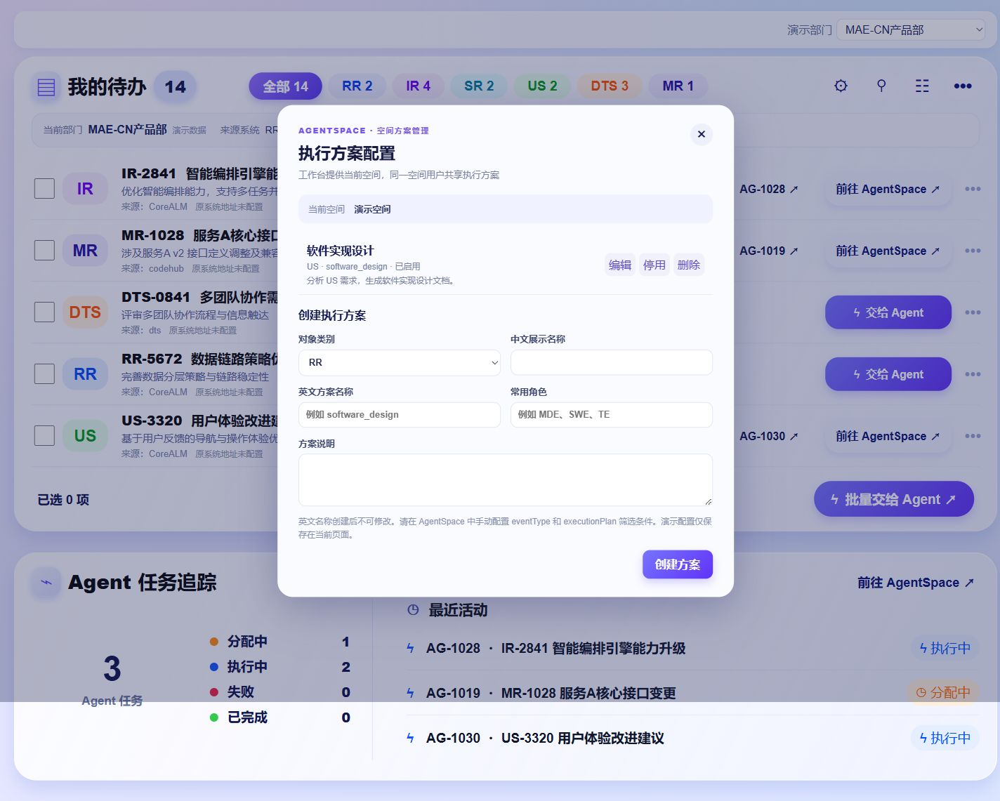
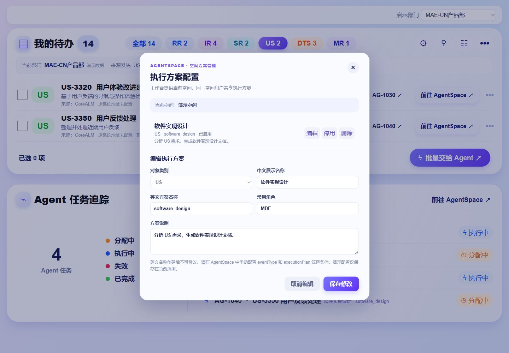
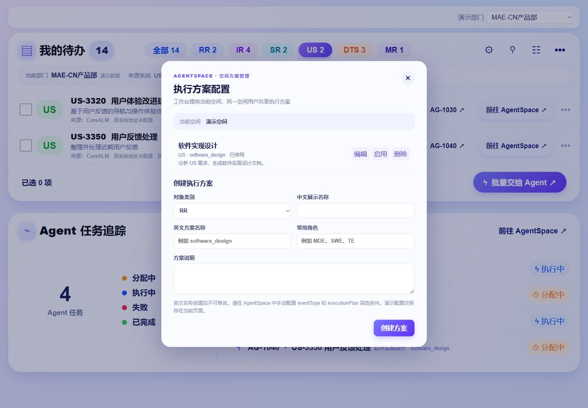
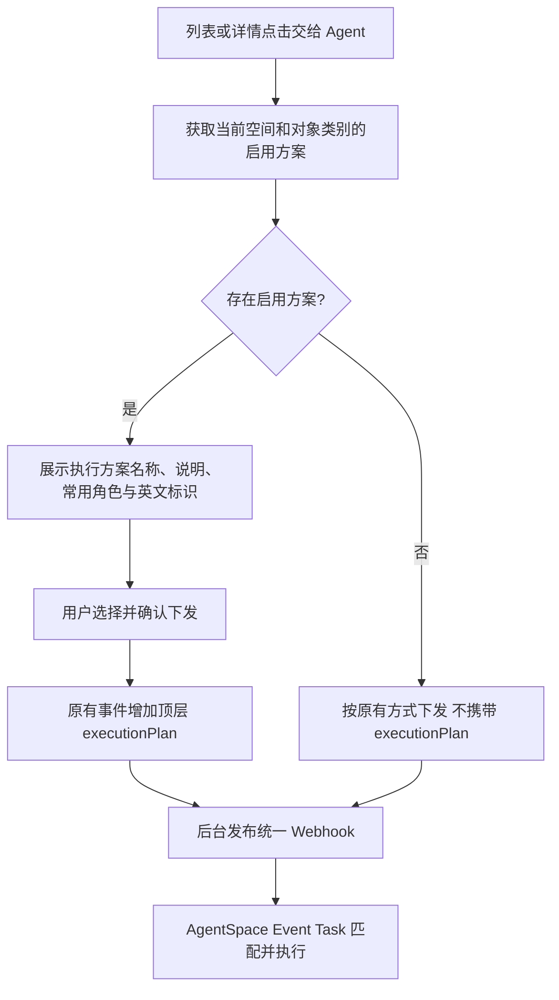
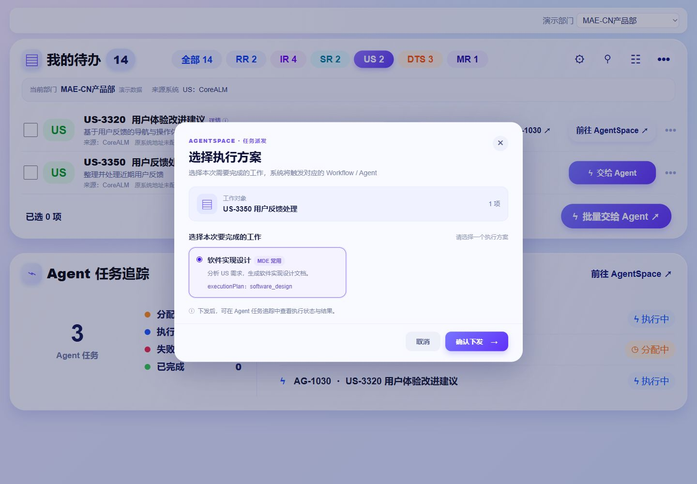
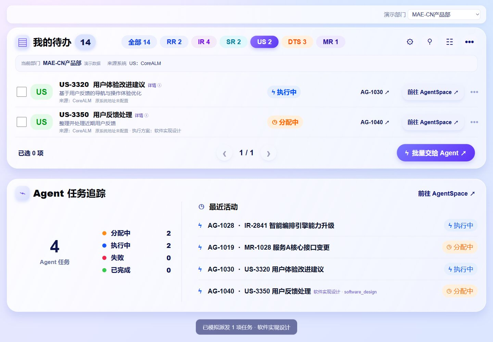

# Widget 新增功能需求澄清

| 项目 | 内容 |
|---|---|
| 版本 | 1.2 |
| 日期 | 2026-11-24 |
| 文档用途 | 汇总本轮对话已明确的业务规则和新增功能交互，供设计、研发及演示讲解使用 |
| 关联规格 | [REQ-001 待办交互](../requirements/REQ-001-todo-agent-widget.md)、[REQ-002 执行方案选择](../requirements/REQ-002-execution-plan-selection.md)、[REQ-003 方案配置](../requirements/REQ-003-custom-execution-plan.md)、[REQ-004 部门差异](../requirements/REQ-004-department-widget-configuration.md) |

## 本次页面变更总览

**本轮设计包含待办信息查看、详情内下发、部门差异和空间执行方案配置；原有跳转原系统能力保留。** 以下是本轮功能设计的整体对照，不表示全部代码均在本次文档刷新中新增。

| 所属区域 / 入口 | 原有或早期演示 | 当前设计 |
|---|---|---|
| Host 画布顶部 | 曾混入执行方案配置入口 | 仅保留演示部门配置，模拟 Host 环境 |
| 我的待办标题区 | 执行方案配置使用文字入口 | 组件内设置图标打开方案管理 |
| 部门及来源 | 固定类别和来源展示 | 部门与来源同排，类别及来源随部门和筛选变化 |
| 待办标题 | 原表格分列展示对象信息 | 卡片摘要，悬浮预览，点击查看完整详情 |
| 原系统跳转 | 原 demo 支持跳转原对象 | 列表及详情均保留独立入口，不与详情或 AgentSpace 跳转混淆 |
| 待办详情 | 查看后需要关闭再下发 | 详情内直接下发或执行当前适用操作 |
| 执行方案 | 对象对应固定任务，早期演示手填执行实体 | 空间内按对象类别创建、编辑、启停、删除方案，使用英文事件标识 |
| 配置对象类别 | 全量固定类别 | 仅当前空间使用的对象类别 |
| Agent 任务状态 | 百分比和进度条 | 分配中、执行中、失败、已完成枚举 |

## 页面截图与验收状态

本轮已通过 HTTP 对关键路径实际操作并截图。完整逐步图解见 [CL-006：关键交互图解](CL-006-key-interactions.md)。文中的部门、创建、详情、方案选择和下发结果截图来自 1440 × 1000 CSS px 视口；各图的操作状态见正文。手机和中等宽度对照见 [CL-005](CL-005-responsive-strategy.md)。

本次修复 MAE-CN 总数徽标固定为 12 的问题，现与“全部 14”一致。验证范围包括创建方案、详情内下发、方案选择、状态回显、编辑英文标识锁定及停用状态；删除确认及真实源系统跳转不在本轮已验证范围内。

## 1. 背景与用户目标

原有待办以表格展示编号、标题和描述，支持跳转来源系统。本次设计在卡片布局中保留工作项信息和原有操作，并补充详情预览、详情内下发、按部门展示以及执行方案管理。

同一个业务对象可能有不同工作目标。以 MAE-CN 的 US 为例，MDE 主要进行软件实现设计，SWE 主要进行代码实现，TE 进行测试设计和执行。用户下发时应能选择本次工作目标，避免每次触发同一个固定任务。

“执行方案”用于表达工作目标及其事件标识。Widget 仍通过工作台后台发布事件；AgentSpace 的 Event Task 根据事件字段匹配 Workflow / Agent。用户不需要在 Widget 中直接选择或调用具体执行实体。

## 2. 页面组织与功能归属

演示页面是一块模拟 AgentSpace Host 的画布，各 Widget 类似桌面插件，作为独立业务组件设计。

| 区域 | 职责及入口 |
|---|---|
| 画布顶部 | 仅用于演示环境配置；当前提供演示部门切换 |
| 我的待办 Widget | 展示当前部门、来源、类别及待办；提供筛选、分页、多选、详情和下发 |
| 我的待办设置图标 | 打开执行方案配置；使用齿轮图标，悬停提示“执行方案配置” |
| Agent 任务追踪 Widget | 展示 Agent 任务、方案信息和枚举状态，提供适用的任务查看入口 |

执行方案配置属于 Widget 业务能力，其入口位于组件内部。弹窗由该入口唤起，不占用画布顶部的演示配置区。

## 3. 部门差异与数据对象

采用“通用 Widget 交互框架 + 部门业务配置”。列表、详情、筛选、下发和任务追踪复用通用交互；部门配置决定适用对象类别、来源及相应业务展示。

| 对象 | 公共产品开发与IT装备部 | MAE-CN产品部 |
|---|---|---|
| RR | edevops | CoreALM |
| FE | edevops | 不使用 |
| IR | 不使用 | CoreALM |
| SR | 不使用 | CoreALM |
| US | edevops | CoreALM |
| DTS | dts | dts |
| MR | codehub | codehub |

交互规则：

1. 获得用户部门后，显示该部门适用的类别及数据来源。
2. 当前部门和来源系统在同一行展示，窄屏允许换行。
3. 选择“全部”时，显示当前部门各类别的来源；选择单个类别时，只显示该类别的来源。
4. MAE-CN 使用 IR 并增加 SR，不展示 FE。真实数据中 IR 和 FE 是独立对象，不通过重命名转换。
5. 特定部门出现独特业务流程时，在相应对象场景扩展交互；不复制整套 Widget。

部门与空间分别承担不同职责：部门决定业务对象和来源；AgentSpace 空间决定执行方案归属、共享范围及管理权限。切换部门不会迁移或清除空间方案。

### 部门页面实际效果

装备部：



MAE-CN：类别为 RR、IR、SR、US、DTS、MR，总数 14。



## 4. 工作项预览和详情内操作

### 4.1 预览

用户将鼠标悬浮在待办标题上，或使用键盘聚焦标题，可预览编号、标题和描述。卡片保留简洁布局，完整信息通过详情查看。

### 4.2 详情

点击待办标题或右侧更多按钮打开详情。触屏用户可直接点击，不依赖悬浮。

列表提供独立的“前往原系统”入口，用户无需打开详情即可跳转到原系统中的对应对象；标题仍用于预览和打开详情。跳转在新标签页打开，保留当前 Widget 页面。

详情展示编号、标题、完整描述、来源系统和任务状态。存在有效来源对象地址时提供“前往来源系统”入口；未配置时列表及详情显示说明，不构造虚假链接。



### 4.3 详情内操作

用户无需先关闭详情再操作。待处理对象在详情中提供“交给 Agent”，失败任务提供“重试”；其他任务提供适用的任务或结果查看操作。点击下发后继续执行方案选择或原有下发流程。

## 5. 执行方案配置

### 5.1 归属和权限

- 方案绑定配置时 Widget 所在的 AgentSpace 空间。
- 当前空间标识由工作台提供，用户无需选择。
- 当前空间中所有可访问用户均可创建和管理方案，使用 AgentSpace 已有的空间访问权限。
- 不同空间的方案分别管理。同一空间的用户共享该空间方案。

### 5.2 创建

用户点击 Widget 内设置图标，进入方案管理弹窗并创建方案。

| 信息 | 规则 |
|---|---|
| 当前空间 | 展示工作台提供的空间上下文 |
| 对象类别 | 只允许选择当前空间使用的对象类别；不展示全量类别，不根据当前分页或待办数量决定选项 |
| 中文展示名称 | 用于界面和任务记录展示 |
| 英文方案名称 | 作为 executionPlan 的值；只允许英文字母、数字及下划线；创建后不可修改 |
| 方案说明 | 说明本次方案完成的工作目标 |
| 常用角色 | 展示常用角色，例如 MDE、SWE、TE |

同一空间、同一对象类别内英文方案名称唯一，不同类别允许重复。字符不合法或存在重复标识时阻止保存并显示原因。当前类别没有待办，不影响其作为空间已使用类别出现在配置选项中。



### 5.3 管理

| 操作 | 交互及结果 |
|---|---|
| 查看 | 显示方案名称、英文标识、对象类别、说明及启用状态 |
| 编辑 | 修改中文名称、说明和常用角色；英文标识和关联类别保持不变 |
| 停用 | 不再出现在下发选项中；保留配置和历史任务 |
| 启用 | 恢复为下发可选项 |
| 删除 | 二次确认后删除；历史任务继续保留创建时的方案名称及英文标识 |

常用角色用于帮助用户理解方案，不作为仅凭角色自动选择任务或限制访问的依据。







## 6. 下发任务与选择方案



选择方案后，在待办和任务追踪中显示所选方案，历史任务保存创建时的中文名和英文标识快照。后续方案编辑、停用或删除不改变历史展示。

批量下发保留原有入口。当前演示对涉及配置方案的混合类别选择，提示按类别分别下发；这一演示交互不代表已实现跨类别方案编排。





## 7. 事件协议及 AgentSpace 配置

统一 Webhook 保留原有 id、eventType 和 data；选择方案时增加顶层 executionPlan，其值为用户填写的英文方案名称。

```json
{
  "id": "event-001",
  "eventType": "US_ANALYSIS",
  "executionPlan": "software_design",
  "data": {
    "objectId": "US-3350"
  }
}
```

本例 eventType 仅说明结构，不定义新的正式事件编码。无启用方案、按原有方式下发时，省略 executionPlan 字段。

用户在 AgentSpace 手动配置 Event Task，通过 eventType 和 executionPlan 联合筛选。Widget 不创建 Event Task、不读取 Workflow / Agent 列表，也不负责直接拉起执行实体。

后台仍承担原有任务台账、Webhook 发布及 Kafka 状态同步职责；本次新增方案选择不改变整体任务链路。

## 8. Agent 任务状态

页面使用四种枚举状态：**分配中、执行中、失败、已完成**。不展示执行百分比、进度条或暗示进度比例的仪表。

尚未下发的业务待办显示“待处理”，它不属于 Agent 任务状态。当前 demo 确认下发后显示“分配中”。真实服务的内部状态按实际接口实现映射，不在本澄清文档中新增内部状态定义。

## 9. 演示走查

1. 在画布顶部切换两个部门，对照类别和来源；切换单个类别，确认来源同步变化。
2. 悬浮和点击工作项查看信息，从详情内直接发起下发。
3. 从待办 Widget 的设置图标进入配置，检查对象类别与当前使用范围一致。
4. 为一个类别创建执行方案，再对该类待办下发，选择方案并查看任务记录。
5. 编辑方案中文名，检查已有任务仍保留原名称；停用后检查下发选项，重新启用后再次检查。
6. 删除方案并确认，检查已有任务的方案名称及英文标识仍保留。
7. 检查任务状态展示仅使用枚举，不出现百分比。

## 10. 当前 demo 的实现边界

页面使用本地样例、单个模拟空间及内存配置；刷新后恢复。部门选择器用于模拟用户上下文，不读取真实身份 Cookie。当前 demo 使用部门业务配置模拟空间可用类别，实际空间对象范围应由 Host 上下文或空间配置提供，不能将部门等同于空间。

页面不提供真实空间鉴权、跨用户共享存储、源系统查询、Webhook 发送或 AgentSpace 配置。此文档确认的是交互和业务规则，走查条目不表示已经完成浏览器验收。

## 11. 变更记录

| 日期 | 版本 | 内容 |
|---|---|---|
| 2026-11-24 | 1.0 | 汇总本轮讨论明确的新增功能及交互规则 |

| 2026-11-24 | 1.1 | 增加页面变更对照、截图及验收状态、独立澄清记录链接 |

| 2026-11-24 | 1.2 | 补齐关键交互实际截图、验证结果及响应式记录链接 |
