# Widget 页面交互设计

版本：1.3；更新日期：2026-11-24。

本文件描述当前页面交互和实际截图；业务规则以[需求规格](../requirements/README.md)为准。逐轮变化见[设计变更](../changes/README.md)，演示入口为 [HTTP 页面](http://127.0.0.1:8000/)。

## 本轮变更

本次仅整理文档：完整交互设计从 clarifications 迁入 design，合并重复图解，业务规则回归 REQ。未修改页面行为，复用已经取得的实际截图，不生成无变化的新截图。

## 1. Host 画布及部门首页

画布顶部仅提供演示部门选择；业务操作均在所属 Widget 内。真实用户上下文和空间标识由工作台提供，演示通过本地配置模拟。

“我的待办”展示部门、来源、类别、事项及操作。设置图标打开执行方案管理。部门差异及来源映射见 [REQ-004](../requirements/REQ-004-department-widget-configuration.md)。当前部门和来源同排；选择单一类别时来源收敛到该类别。

装备部首页：

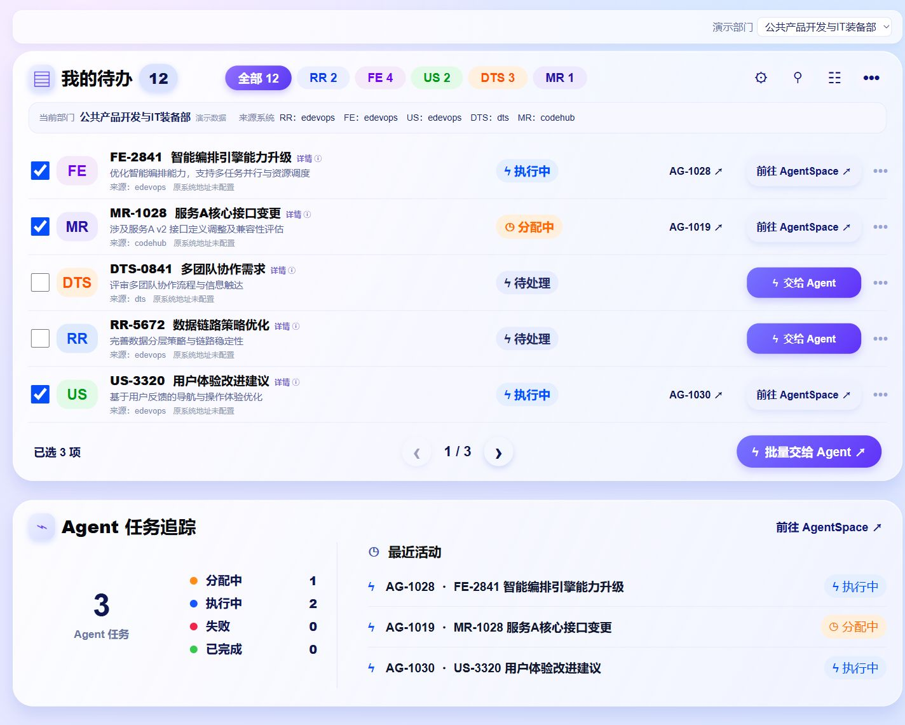

MAE-CN 首页使用 IR 和 SR，总数 14：

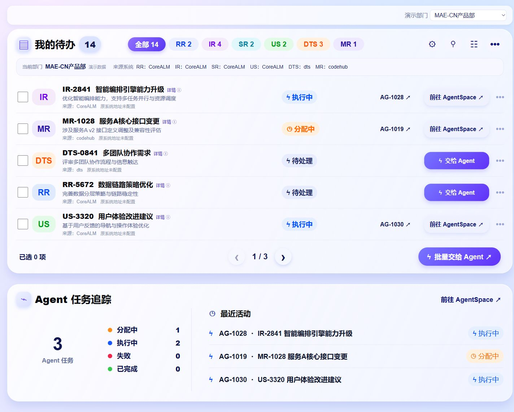

选择 US，来源只显示 CoreALM：

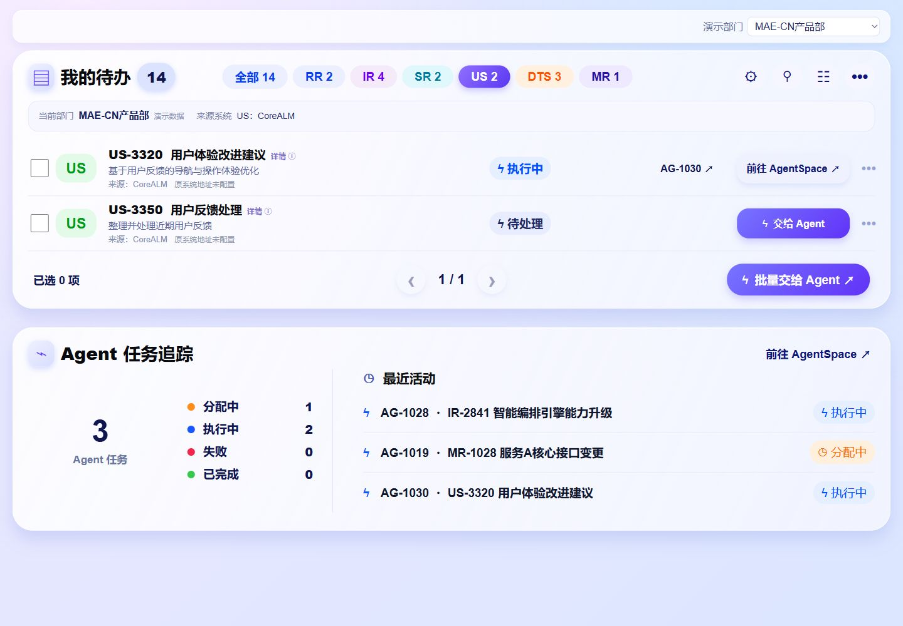

## 2. 待办预览、详情与原系统跳转

标题悬浮或键盘聚焦可预览编号、标题、描述；点击标题或更多按钮打开详情。详情支持触屏点击访问，包含工作项信息和当前适用操作。原系统跳转与 AgentSpace 任务跳转独立存在，规则见 [REQ-001](../requirements/REQ-001-todo-agent-widget.md)。

列表及详情在存在有效源对象地址时提供原系统跳转，在新标签页打开具体对象。样例没有真实地址，因此截图显示未配置，不构造虚假链接。

用户可从详情直接点击“交给 Agent”，无需关闭后返回列表。

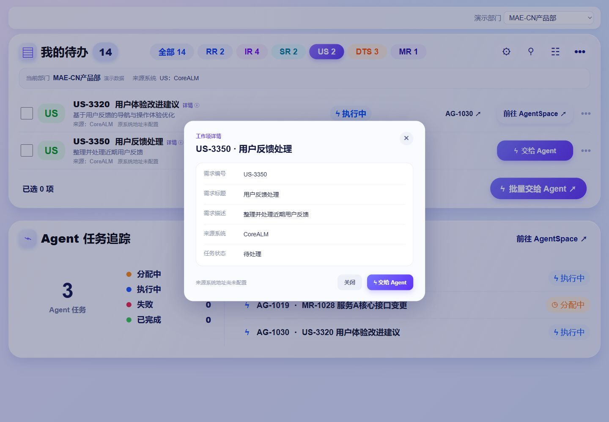

## 3. 创建与管理执行方案

从待办 Widget 的设置图标进入。当前空间自动展示，对象类别只列出该空间使用的类别。字段、唯一性、权限及生命周期规则统一见 [REQ-003](../requirements/REQ-003-custom-execution-plan.md)。

创建示例：US、软件实现设计、software_design、MDE，以及工作说明。不配置或拉取 Workflow / Agent 列表。

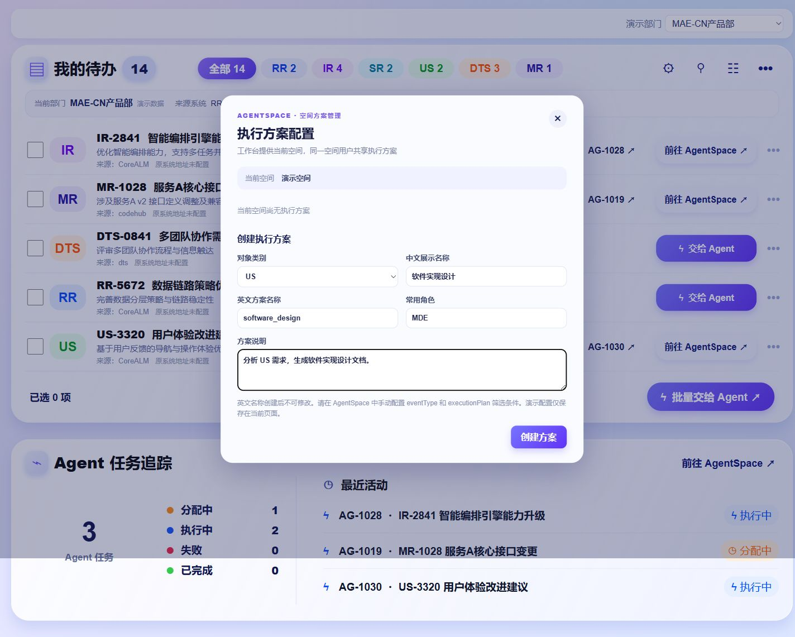

创建后显示方案及编辑、停用和删除操作：

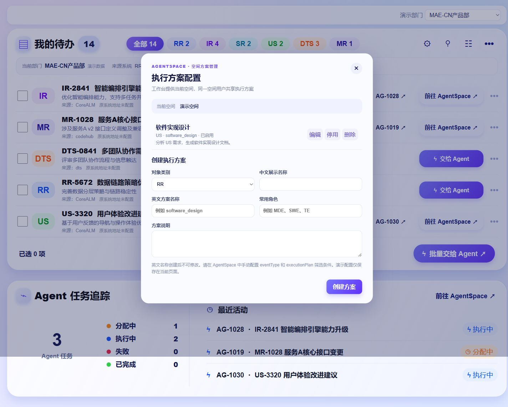

编辑时英文标识及类别锁定：

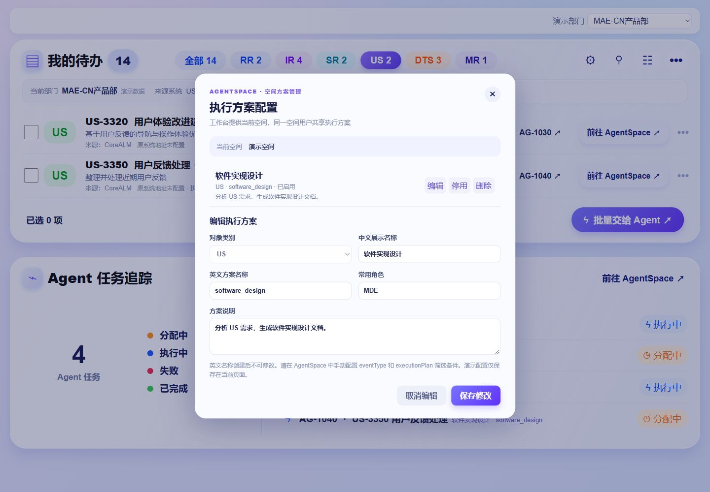

停用后显示启用操作；已经创建的任务继续显示其方案快照：

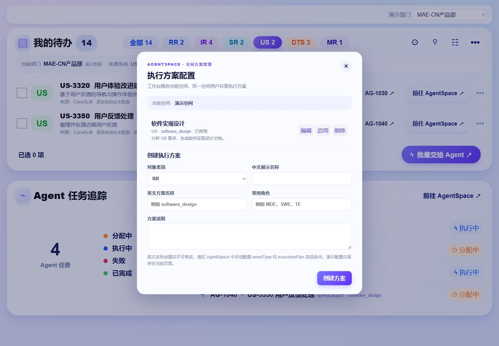

## 4. 下发选择与任务回显

详情或列表下发均进入相同流程，规则见 [REQ-002](../requirements/REQ-002-execution-plan-selection.md)。有启用方案时显示工作目标、说明、角色和英文标识；未选择时确认按钮禁用。无启用方案时保留原有下发流程。

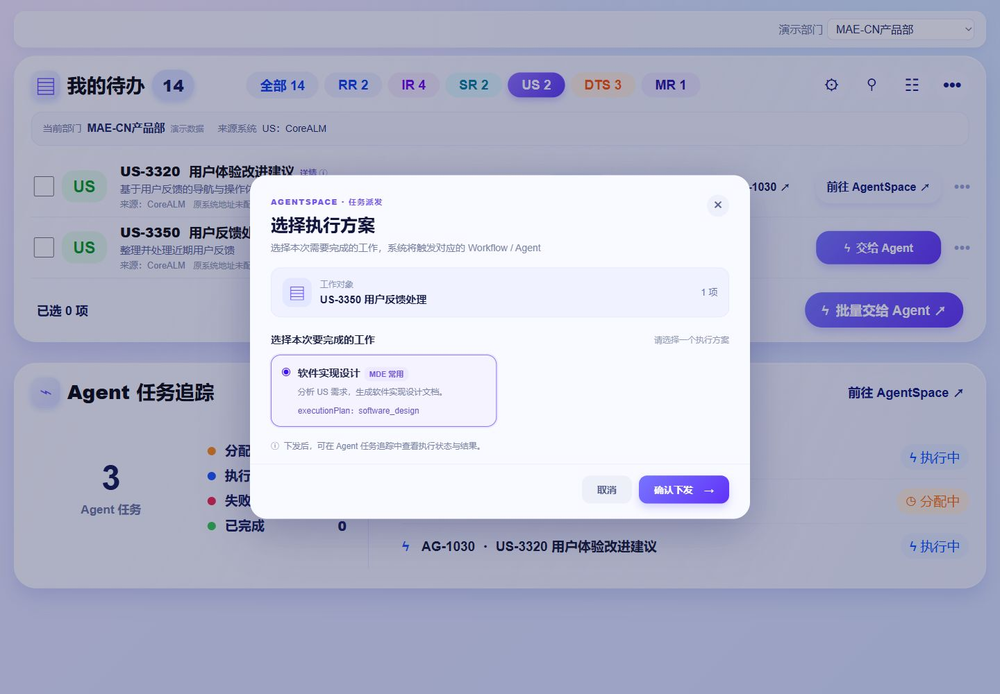

确认后显示分配中；追踪区新增任务并显示方案名称及英文标识。本图 US-3350 下发后，追踪总数为 4：

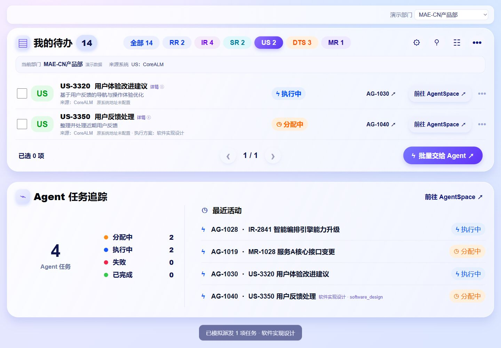

Webhook 顶层 executionPlan、eventType 联合筛选以及历史快照规则见 REQ-003。Widget 发布事件，不直接拉起执行实体。

## 5. 自适应布局

宽屏采用列式浏览，中等宽度以摘要和状态操作两层组织，手机采用紧凑摘要及操作区。检查信息密度、层级和操作可达性，不只检查无溢出。演变过程和前后截图见 [CL-005](../changes/CL-005-responsive-strategy.md)。

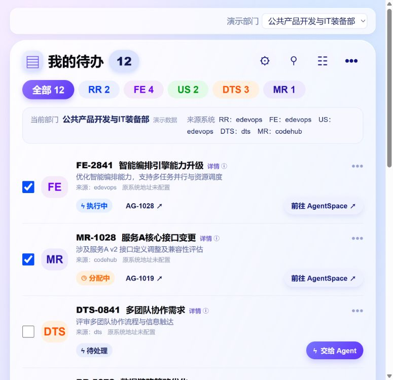

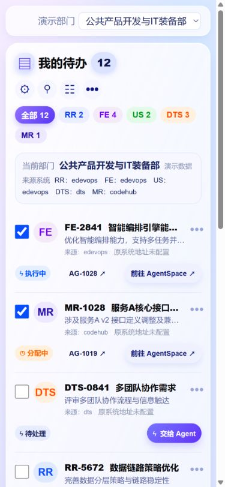

## 6. 实际验证及演示边界

关键交互截图使用 MAE-CN 或装备部，视口为 1440 × 1000 CSS px，完整页面截图高度可以超过视口；响应式截图为 790 和 390 CSS px。

已实际验证部门切换、方案创建、类别筛选、详情内下发、方案选择、分配中和方案回显、编辑英文标识锁定、停用状态，以及三个尺寸无页面横向溢出。已修复 MAE-CN 徽标固定为 12 的问题。

截图不表示真实业务集成或所有分支均验收通过。本轮证据不覆盖真实来源跳转、跨用户空间权限、后端 Webhook 发送、删除确认或全部失败分支。demo 使用单个模拟空间、样例和内存配置，刷新后清除。空间对象类别在 demo 中借助部门配置模拟，实际应由空间配置提供。

## 变更记录

| 日期 | 版本 | 内容 |
|---|---|---|
| 2026-11-24 | 1.0–1.2 | 形成交互设计并补齐实际截图 |
| 2026-11-24 | 1.3 | 归入 design，合并重复图解，规则引用统一 REQ |
