# AI工作台 MVP 后台服务软件实现设计

**版本：V2.0**

**技术栈：Java Spring Boot + PostgreSQL + MyBatis**

---

# 1. 需求背景

## 1.1 业务背景

AI工作台面向团队研发作业过程中的高频业务对象，提供研发待办管理及AI Agent任务触发能力。

MVP阶段围绕RR、MR、检视问题、流水线等研发业务对象，建设以下核心场景：

1. 用户进入工作桌面，在我的待办Widget中查看待处理事项及历史已完成任务。
2. 用户针对待办事项触发Agent任务，工作台后台通过AgentSpace Webhook发布事件。
3. AgentSpace根据事件的eventType字段匹配已配置的Event Task，启动对应Workflow / Agent。
4. AgentSpace通过Kafka推送任务状态，工作台后台维护任务台账并向Widget提供任务状态。
5. 用户通过Widget跳转AgentSpace，查看完整的任务执行过程。

## 1.2 MVP业务范围

| 业务场景 | 业务对象 | 核心操作 |
|---|---|---|
| RR需求分析 | RR | 查看待分析RR，触发需求分析Agent |
| MR检视问题分析 | MR、检视问题 | 查看存在未闭环检视问题的MR，触发分析Agent |
| MR流水线故障诊断 | MR、流水线 | 查看流水线异常的MR，触发诊断Agent |
| Agent任务管理 | Agent任务 | 查看任务状态、历史任务及任务详情 |

## 1.3 系统边界

| 系统 | 职责 |
|---|---|
| Widget | 研发待办展示、Agent任务触发、任务状态展示及任务跳转 |
| 研发作业系统 | 提供RR、MR、检视问题、流水线等研发业务数据 |
| AiAgentManageService | Agent任务创建、Webhook发布、任务台账管理、Kafka状态同步 |
| AgentSpace | 事件匹配、Workflow / Agent执行及任务观测 |
| Kafka | AgentSpace向工作台推送任务状态事件 |
| PostgreSQL | 保存工作台创建的Agent任务台账 |

研发业务数据由Widget直接调用研发作业系统人机接口获取，使用Cookie进行用户鉴权，支持跨域访问。

AiAgentManageService不代理研发作业系统接口，不存储研发业务数据。

## 1.4 技术选型

| 技术领域 | 技术选型 |
|---|---|
| 后端框架 | Java Spring Boot |
| 数据库 | PostgreSQL |
| 数据访问 | MyBatis |
| 前后端通信 | REST API |
| 用户身份 | Cookie + X-User-Id |
| 事件发布 | AgentSpace Webhook |
| 消息订阅 | Kafka |
| 前端承载 | Widget |

---

# 2. 架构设计

## 2.1 整体架构

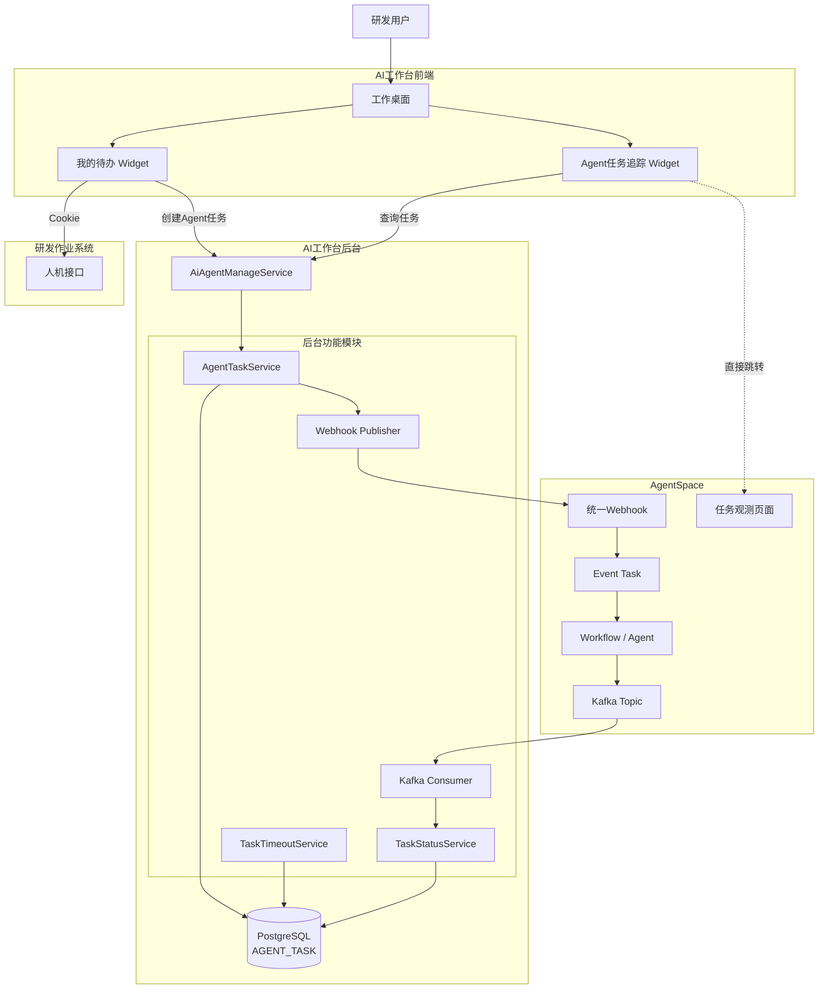

## 2.2 服务职责

### 2.2.1 Widget

| 功能模块 | 职责 |
|---|---|
| 我的待办 | 调用研发作业系统接口，获取并展示待处理事项 |
| 历史已完成 | 展示当前用户历史已完成的Agent任务 |
| Agent任务触发 | 将eventType、taskName及业务参数提交给后台 |
| Agent任务追踪 | 查询任务台账，展示进行中及已完成任务 |
| 任务详情 | 根据任务列表返回的detailUrl跳转AgentSpace |

### 2.2.2 AiAgentManageService

后台采用Spring Boot单体应用，按照业务职责划分内部模块。

| 模块 | 主要职责 |
|---|---|
| AgentTaskController | 提供任务创建、列表查询接口 |
| AgentTaskService | 创建任务、维护任务台账、查询用户任务 |
| EventPublisher | 生成Webhook请求并调用AgentSpace |
| ProgressConsumer | 消费AgentSpace Kafka Topic |
| TaskStatusService | 解析Kafka消息、关联任务、更新任务状态 |
| TaskTimeoutService | 定时检测任务启动超时 |

### 2.2.3 AgentSpace

| 功能 | 职责 |
|---|---|
| Webhook | 接收工作台发布的统一事件 |
| Event Task | 根据eventType过滤事件 |
| Workflow / Agent | 执行对应Agent任务 |
| Kafka | 推送任务状态事件 |
| 任务观测页面 | 展示完整任务执行信息 |

## 2.3 核心数据链路

工作台通过Webhook请求中的`id`与Kafka消息关联。

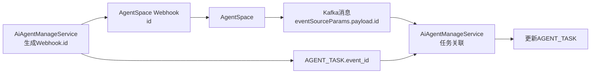

### 2.3.1 ID定义

| 标识 | 生成方 | 业务含义 | 数据库存储字段 |
|---|---|---|---|
| Webhook `id` | AiAgentManageService | 工作台业务事件ID，任务关联键 | event_id |
| Kafka `eventId` | AgentSpace | Kafka状态事件ID | last_event_id |
| Kafka `taskId` | AgentSpace | AgentSpace任务ID | agent_task_id |
| Kafka `executionId` | AgentSpace | AgentSpace执行ID | execution_id |

关联关系：

```text
AGENT_TASK.event_id
        =
Webhook.id
        =
Kafka.eventSourceParams.payload.id
```

AgentSpace生成的taskId、executionId用于保存任务执行信息，不作为工作台任务的首次关联键。

## 2.4 用户身份传递

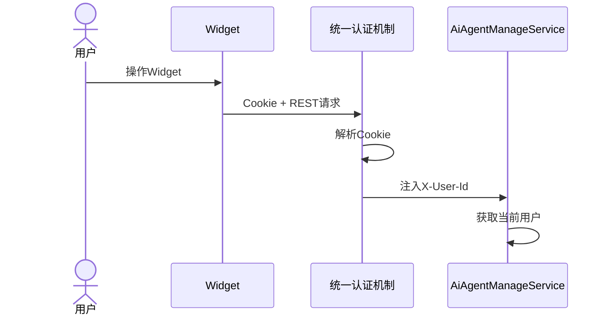

| 项目 | 约定 |
|---|---|
| 前端传递 | Cookie |
| 身份解析 | 现有统一认证机制 |
| 后台获取用户 | X-User-Id |
| 数据库操作人 | operator |
| operator来源 | X-User-Id |

Widget不在业务请求体中传递operator。

## 2.5 Agent事件类型

MVP初始事件类型：

| eventType | 业务场景 | 对应Agent能力 |
|---|---|---|
| RR_ANALYSIS | RR需求分析 | 需求分析 |
| MR_REVIEW_ANALYSIS | MR检视问题分析 | 检视问题分析 |
| MR_PIPELINE_DIAGNOSIS | MR流水线故障诊断 | 流水线故障诊断 |

AgentSpace通过eventType配置Event Task过滤条件，并匹配对应Workflow / Agent。

## 2.6 Agent任务状态模型

工作台任务状态由工作台本地状态和AgentSpace任务状态组成。

### 2.6.1 工作台本地状态

| 状态 | 含义 | 进入条件 |
|---|---|---|
| PUBLISHING | 正在发布Webhook | 开始调用Webhook |
| PUBLISHED | Webhook发布成功，等待AgentSpace状态 | Webhook明确返回成功 |
| START_TIMEOUT | 启动超时，尚未收到有效Kafka状态 | 超过配置时长仍未收到状态 |
| PUBLISH_FAILED | Webhook明确发布失败 | Webhook返回明确失败 |

### 2.6.2 AgentSpace任务状态

| 状态 | 语义 | 终态 |
|---|---|---|
| TODO | 待执行 | 否 |
| QUEUED | 排队中（并发受限） | 否 |
| RUNNING | 执行中 | 否 |
| WAITING_APPROVAL | 待人工确认/审批 | 否 |
| SUCCEEDED | 成功 | 是 |
| FAILED | 失败（含启动失败，携带errorMessage） | 是 |
| CANCELLED | 已取消 | 是 |

### 2.6.3 状态分组

| 分组 | 包含状态 |
|---|---|
| ACTIVE | PUBLISHING、PUBLISHED、START_TIMEOUT、TODO、QUEUED、RUNNING、WAITING_APPROVAL |
| COMPLETED | SUCCEEDED、FAILED、CANCELLED、PUBLISH_FAILED |

### 2.6.4 状态流转说明

Agent任务状态分为工作台本地状态和AgentSpace执行状态两个阶段。

1. **任务发布阶段**：任务创建后进入`PUBLISHING`。Webhook调用成功后进入`PUBLISHED`；明确发布失败后进入`PUBLISH_FAILED`。
2. **任务启动阶段**：任务处于`PUBLISHED`时，后台等待AgentSpace Kafka状态消息。超过配置的等待时间仍未收到有效消息，则标记为`START_TIMEOUT`。
3. **任务执行阶段**：收到Kafka状态消息后，根据消息中的`toStatus`更新任务状态。AgentSpace任务可能处于`TODO`、`QUEUED`、`RUNNING`或`WAITING_APPROVAL`。
4. **任务结束阶段**：收到终态消息后，任务进入`SUCCEEDED`、`FAILED`或`CANCELLED`，并记录任务结束时间。其中，`FAILED`同时保存Kafka消息中的`errorMessage`。

`START_TIMEOUT`仅表示尚未收到AgentSpace任务状态，不代表任务执行失败。`SUCCEEDED`、`FAILED`和`CANCELLED`为终态。

---

# 3. 关键UC与时序图

## 3.1 UC-01：查看我的待办

### 参与者

研发用户、我的待办Widget、研发作业系统、AiAgentManageService。

### 前置条件

用户已登录工作台。

### 主流程

1. 用户进入工作桌面。
2. Widget调用研发作业系统人机接口。
3. 研发系统返回当前用户相关业务数据。
4. Widget根据业务条件组合待办。
5. 用户在待处理和已完成Tab之间切换。
6. 已完成Tab通过AiAgentManageService查询历史已完成Agent任务。

### 待办分类

| Tab | 业务类型 | 查询条件 | 数据来源 |
|---|---|---|---|
| 待处理 | RR | 责任人为当前用户，状态待分析 | 研发作业系统 |
| 待处理 | MR检视问题 | MR创建人为当前用户，存在未闭环检视问题 | 研发作业系统 |
| 待处理 | MR流水线异常 | MR创建人为当前用户，流水线状态异常 | 研发作业系统 |
| 已完成 | Agent历史任务 | 当前用户创建且任务已进入终态 | AiAgentManageService |

### 时序图

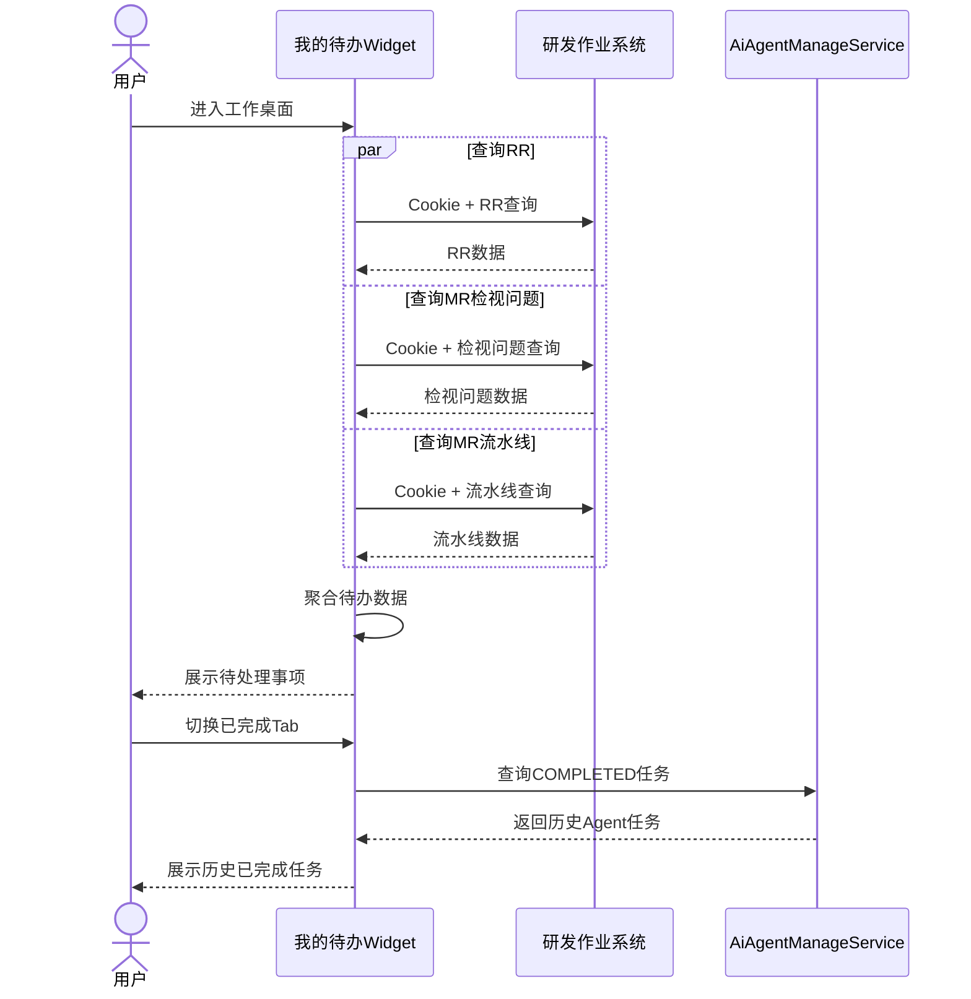

## 3.2 UC-02：触发Agent任务

### 参与者

研发用户、Widget、AiAgentManageService、PostgreSQL、AgentSpace。

### 前置条件

用户已登录，Agent任务对应的事件类型已在AgentSpace配置。

### 主流程

1. 用户在Widget选择待办事项。
2. 用户触发对应Agent能力。
3. Widget提交eventType、taskName及业务参数。
4. AiAgentManageService获取当前用户X-User-Id。
5. 后台生成Webhook.id。
6. 后台创建AGENT_TASK记录。
7. 后台构造统一Webhook请求。
8. 后台调用AgentSpace Webhook。
9. Webhook调用成功后更新任务状态为PUBLISHED。
10. 返回任务信息。

### 时序图

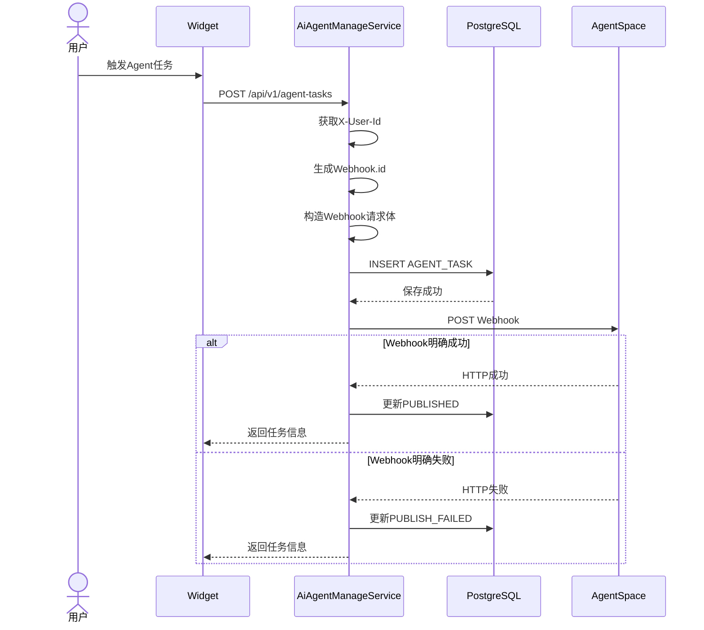

### 业务约束

- 一个工作台任务对应一次Webhook发布。
- Webhook.id由后台生成。
- operator由X-User-Id获取。
- 完整Webhook请求体保存至request_data。
- Webhook调用成功不代表Agent任务已经启动。

## 3.3 UC-03：AgentSpace事件匹配及执行

### 参与者

AgentSpace Webhook、Event Task、Workflow / Agent、Kafka。

### 主流程

1. AgentSpace接收Webhook。
2. Event Task根据eventType过滤事件。
3. 匹配对应Workflow / Agent。
4. AgentSpace创建并启动任务。
5. Workflow / Agent执行任务。
6. AgentSpace通过Kafka推送任务状态变化。

### 时序图

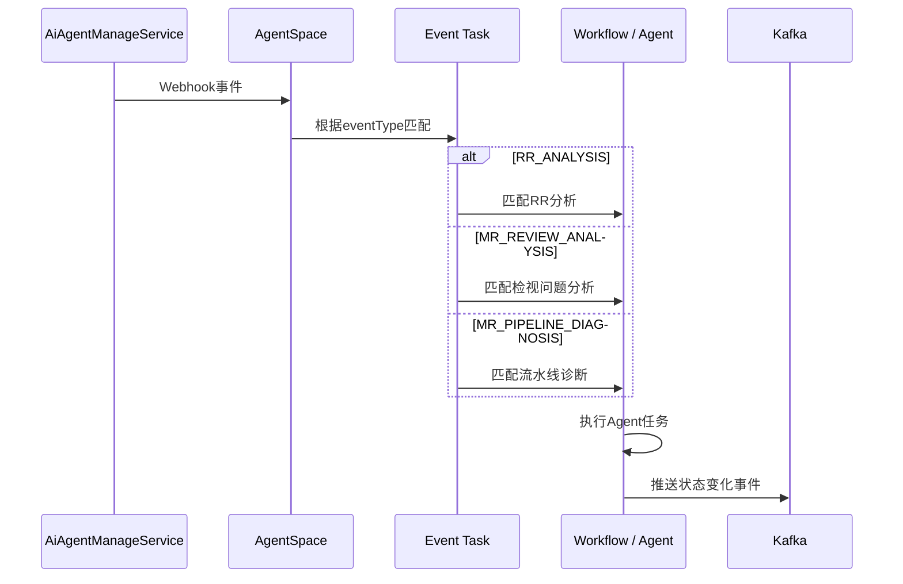

## 3.4 UC-04：Kafka任务状态同步

### 参与者

AgentSpace、Kafka、AiAgentManageService、PostgreSQL。

### 主流程

1. AgentSpace推送任务状态事件至Kafka。
2. AiAgentManageService消费消息。
3. 解析eventSourceParams.payload.id。
4. 根据AGENT_TASK.event_id查询工作台任务。
5. 更新AgentSpace taskId、executionId。
6. 根据toStatus更新工作台任务状态。
7. 保存最近一次Kafka eventId及失败原因。
8. 数据库事务提交成功后确认Kafka消息。

### 时序图

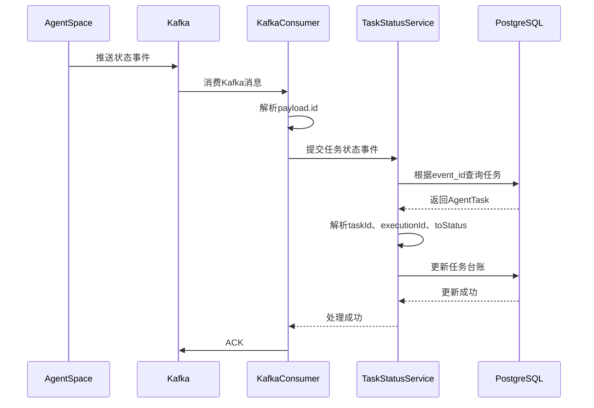

### Kafka与数据库字段映射

| Kafka字段 | AGENT_TASK字段 | 处理规则 |
|---|---|---|
| eventSourceParams.payload.id | event_id | 关联工作台任务 |
| taskId | agent_task_id | 保存AgentSpace任务ID |
| executionId | execution_id | 保存执行ID |
| eventId | last_event_id | 保存最近一次Kafka事件ID |
| toStatus | status | 更新任务状态 |
| errorMessage | error_message | 保存失败原因 |
| toStatus首次进入RUNNING | started_at | 记录开始时间 |
| toStatus进入终态 | finished_at | 记录结束时间 |

## 3.5 UC-05：任务启动超时

### 主流程

1. Webhook发布成功，任务进入PUBLISHED。
2. 后台按照配置的启动等待时间进行检测。
3. 超过等待时间仍未收到有效Kafka状态事件，任务进入START_TIMEOUT。
4. START_TIMEOUT任务继续保留在任务台账中，不标记为执行失败。

### 时序图

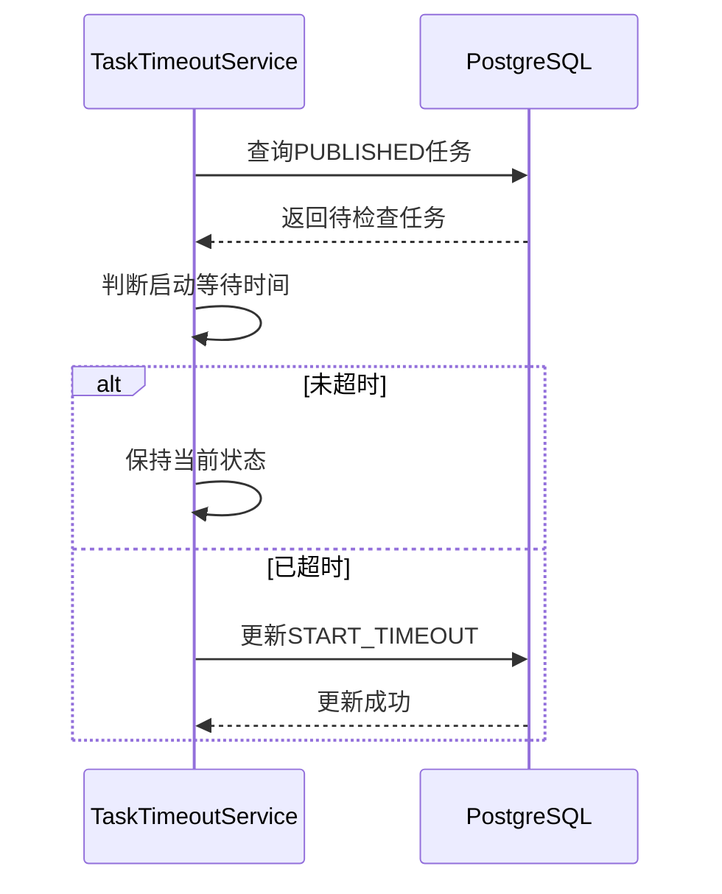

### 超时判定规则

启动超时仅针对尚未收到任何有效AgentSpace任务状态的PUBLISHED任务。

收到以下任意状态后，不再执行启动超时检测：

- TODO
- QUEUED
- RUNNING
- WAITING_APPROVAL
- SUCCEEDED
- FAILED
- CANCELLED

START_TIMEOUT不代表Agent执行失败，不自动重新发布Webhook。

## 3.6 UC-06：查询Agent任务及跳转

### 参与者

用户、Agent任务Widget、AiAgentManageService、PostgreSQL、AgentSpace。

### 主流程

1. 用户打开Agent任务Widget。
2. Widget请求当前用户的Agent任务列表。
3. 后台根据X-User-Id查询当前用户任务。
4. 后台根据AgentSpace taskId生成任务详情地址detailUrl。
5. Widget展示任务列表及状态。
6. 进行中任务定时轮询。
7. 用户点击任务详情，Widget直接跳转AgentSpace。
8. 任务进入终态后，Widget将任务展示在已完成Tab。

### 时序图

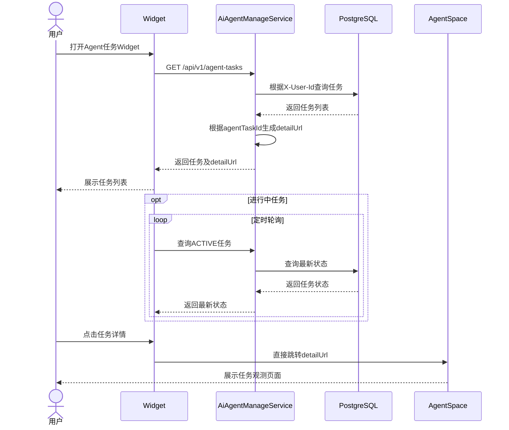

### 查询分组

| 分组 | 包含状态 |
|---|---|
| ACTIVE | PUBLISHING、PUBLISHED、START_TIMEOUT、TODO、QUEUED、RUNNING、WAITING_APPROVAL |
| COMPLETED | SUCCEEDED、FAILED、CANCELLED、PUBLISH_FAILED |

### 详情跳转规则

| 条件 | detailUrl |
|---|---|
| 已获得AgentSpace taskId | 返回任务详情地址 |
| 尚未获得AgentSpace taskId | null |

Widget仅在detailUrl不为空时展示任务详情入口。

AgentSpace任务观测页面负责提供执行阶段、运行日志及其他详细观测信息。

---

# 4. 接口设计

## 4.1 接口清单

### 4.1.1 Widget与AiAgentManageService

| 序号 | 接口名称 | Method | URL | 用途 |
|---|---|---|---|---|
| 1 | 创建Agent任务 | POST | `/api/v1/agent-tasks` | 创建任务并触发Agent |
| 2 | 查询Agent任务列表 | GET | `/api/v1/agent-tasks` | 查询当前用户任务 |

任务详情信息通过任务列表接口统一返回，不单独提供详情查询接口。

### 4.1.2 接口认证

Widget调用AiAgentManageService时携带Cookie。

后台通过现有统一认证机制解析Cookie，并注入：

```http
X-User-Id: y00591263
```

所有任务查询均根据当前用户X-User-Id过滤。

operator不接受前端传入。

## 4.2 统一响应结构

```json
{
  "code": "0",
  "message": "success",
  "data": {}
}
```

| 字段 | 类型 | 说明 |
|---|---|---|
| code | String | 响应状态码 |
| message | String | 响应信息 |
| data | Object | 业务响应数据 |

接口时间统一采用ISO 8601格式。

示例：

```text
2026-11-18T10:00:00
```

## 4.3 创建Agent任务

### 基本信息

| 项目 | 定义 |
|---|---|
| 接口名称 | 创建Agent任务 |
| Method | POST |
| URL | `/api/v1/agent-tasks` |
| Content-Type | application/json |
| 身份认证 | Cookie |
| 操作人 | X-User-Id |

### 请求体

```json
{
  "eventType": "MR_PIPELINE_DIAGNOSIS",
  "taskName": "MR流水线故障诊断",
  "data": {
    "mrId": "MR-1001",
    "pipelineId": "pipeline-001",
    "commitId": "commit-001"
  }
}
```

### 请求字段

| 字段 | 类型 | 必填 | 说明 |
|---|---|---|---|
| eventType | String | 是 | Agent事件类型 |
| taskName | String | 是 | 任务名称 |
| data | Object | 是 | Agent执行所需业务参数 |

### 响应体

```json
{
  "code": "0",
  "message": "success",
  "data": {
    "eventId": "DTS202611180001",
    "status": "PUBLISHED",
    "createdAt": "2026-11-18T10:00:00"
  }
}
```

### 响应字段

| 字段 | 类型 | 说明 |
|---|---|---|
| eventId | String | 工作台Webhook业务事件ID |
| status | String | 当前任务状态 |
| createdAt | String | 创建时间 |

### 后台处理流程

1. 获取X-User-Id。
2. 校验eventType及业务参数。
3. 生成Webhook.id。
4. 保存AGENT_TASK。
5. 构造Webhook请求体。
6. 调用AgentSpace。
7. 根据调用结果更新任务状态。
8. 返回任务信息。

## 4.4 查询Agent任务列表

### 基本信息

| 项目 | 定义 |
|---|---|
| 接口名称 | 查询Agent任务列表 |
| Method | GET |
| URL | `/api/v1/agent-tasks` |
| 身份认证 | Cookie + X-User-Id |

### 请求参数

| 参数 | 类型 | 必填 | 说明 |
|---|---|---|---|
| statusGroup | String | 是 | ACTIVE / COMPLETED |
| eventType | String | 否 | 事件类型过滤 |
| page | Integer | 否 | 页码 |
| pageSize | Integer | 否 | 每页数量 |

### 请求示例

```http
GET /api/v1/agent-tasks?statusGroup=ACTIVE&page=1&pageSize=20
```

### 查询规则

| statusGroup | 包含状态 |
|---|---|
| ACTIVE | PUBLISHING、PUBLISHED、START_TIMEOUT、TODO、QUEUED、RUNNING、WAITING_APPROVAL |
| COMPLETED | SUCCEEDED、FAILED、CANCELLED、PUBLISH_FAILED |

查询条件：

```sql
WHERE operator = #{currentUserId}
```

### 响应体

```json
{
  "code": "0",
  "message": "success",
  "data": {
    "total": 1,
    "page": 1,
    "pageSize": 20,
    "records": [
      {
        "eventId": "DTS202611180001",
        "eventType": "MR_PIPELINE_DIAGNOSIS",
        "taskName": "MR流水线故障诊断",
        "status": "RUNNING",
        "agentTaskId": "2122941637847404544",
        "executionId": "4183503b-9a91-45c2-899a-14b2a8b79713",
        "errorMessage": null,
        "createdAt": "2026-11-18T10:00:00",
        "startedAt": "2026-11-18T10:02:00",
        "finishedAt": null,
        "detailUrl": "https://agentspace.example.com/tasks/2122941637847404544"
      }
    ]
  }
}
```

### 列表字段

| 字段 | 类型 | 说明 |
|---|---|---|
| eventId | String | 工作台事件ID |
| eventType | String | 事件类型 |
| taskName | String | 任务名称 |
| status | String | 当前任务状态 |
| agentTaskId | String | AgentSpace任务ID |
| executionId | String | AgentSpace执行ID |
| errorMessage | String | 任务失败原因 |
| createdAt | String | 创建时间 |
| startedAt | String | 开始时间 |
| finishedAt | String | 结束时间 |
| detailUrl | String | AgentSpace任务详情地址 |

### detailUrl生成规则

后台根据配置的AgentSpace任务详情URL模板及agentTaskId生成。

当agentTaskId为空时，detailUrl返回null。

---

# 5. 外部系统依赖

## 5.1 研发作业系统

### 5.1.1 调用关系

研发作业系统的人机接口由Widget直接调用。

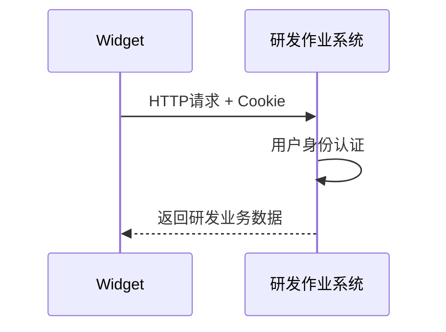

### 5.1.2 接口依赖清单

| 序号 | 业务接口 | 调用方 | 认证方式 | 用途 |
|---|---|---|---|---|
| 1 | RR查询接口 | 我的待办Widget | Cookie | 查询待分析RR |
| 2 | MR查询接口 | 我的待办Widget | Cookie | 查询当前用户MR |
| 3 | 检视问题查询接口 | 我的待办Widget | Cookie | 查询未闭环检视问题 |
| 4 | 流水线查询接口 | 我的待办Widget | Cookie | 查询流水线异常 |

具体URL、请求方法、参数及响应结构使用研发作业系统已有接口契约。

### 5.1.3 调用约束

- Widget直接调用研发作业系统人机接口。
- 使用当前用户Cookie完成鉴权。
- 支持跨域访问。
- AiAgentManageService不代理上述接口。
- 研发业务数据不写入工作台数据库。

## 5.2 AgentSpace Webhook

### 5.2.1 基本信息

| 项目 | 定义 |
|---|---|
| 调用方 | AiAgentManageService |
| 接收方 | AgentSpace |
| Method | POST |
| URL | 服务端配置 |
| Content-Type | application/json |

### 5.2.2 请求体

```json
{
  "id": "DTS202611180001",
  "eventType": "MR_PIPELINE_DIAGNOSIS",
  "data": {
    "mrId": "MR-1001",
    "pipelineId": "pipeline-001",
    "commitId": "commit-001"
  }
}
```

### 5.2.3 字段定义

| 字段 | 类型 | 来源 | 说明 |
|---|---|---|---|
| id | String | 后台生成 | 工作台业务事件ID |
| eventType | String | Widget | 业务事件类型 |
| data | Object | Widget | 业务上下文 |

### 5.2.4 请求处理

1. 后台生成全局唯一id。
2. 保存完整Webhook请求体。
3. 调用AgentSpace统一Webhook。
4. Webhook明确成功后更新PUBLISHED。
5. Webhook明确失败后更新PUBLISH_FAILED。
6. Webhook响应结果不确定时保留任务记录，通过后续Kafka消息确认任务是否实际启动。

Webhook不额外传递eventId、operator或AgentSpace taskId。

## 5.3 AgentSpace Kafka

### 5.3.1 消费配置

| 配置项 | 说明 |
|---|---|
| Bootstrap Servers | Kafka Broker地址 |
| Topic | AgentSpace任务状态Topic |
| Consumer Group | 工作台Kafka消费组 |
| Offset | 按Kafka消费组管理 |
| ACK时机 | 数据库事务提交成功后 |

### 5.3.2 Kafka消息结构

以下为实际Kafka消息的主要结构：

```json
{
  "eventId": "c736a88e-355f-4561-ba29-2093562949e4",
  "eventType": "STEP",
  "teamSpaceId": "2076649528709414912",
  "taskId": "2122941637847404544",
  "executionId": "4183503b-9a91-45c2-899a-14b2a8b79713",
  "taskName": "测试webhook",
  "agentName": "测试webhook与kafka",
  "eventTaskName": "测试webhook",
  "executeMode": "AGENT",
  "taskType": "EVENT",
  "fromStatus": "TODO",
  "toStatus": "RUNNING",
  "triggeredBy": "y00591263",
  "flowId": null,
  "flowName": null,
  "errorMessage": null,
  "eventSourceParams": {
    "payload": {
      "id": "DTS202601010001",
      "data": "{\"description\":\"用户反馈登录失败\",\"severity\":\"P1\"}",
      "eventType": "Test"
    }
  },
  "seqNo": 137163,
  "traceId": "d79cf0af452d8dfd1a6fd4d3de017fa2"
}
```

### 5.3.3 消费字段

| 字段路径 | 类型 | 说明 | 用途 |
|---|---|---|---|
| eventId | String | Kafka事件ID | 消息去重 |
| eventType | String | Kafka事件类别 | 消息类型识别 |
| taskType | String | 任务类型 | 识别EVENT任务 |
| taskId | String | AgentSpace任务ID | 保存任务关联信息 |
| executionId | String | AgentSpace执行ID | 保存执行关联信息 |
| fromStatus | String | 原任务状态 | 状态转换判断 |
| toStatus | String | 新任务状态 | 更新工作台任务状态 |
| errorMessage | String | 错误信息 | 保存失败原因 |
| eventSourceParams.payload.id | String | Webhook原始ID | 关联AGENT_TASK |
| seqNo | Number | 消息序号 | 消息顺序辅助判断 |

### 5.3.4 消息处理流程

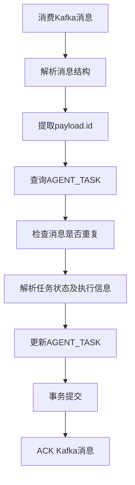

处理要求：

1. 根据eventSourceParams.payload.id关联工作台任务。
2. 根据eventId识别重复消息。
3. 根据toStatus更新任务状态。
4. 保存taskId、executionId、errorMessage。
5. 数据库事务提交成功后ACK。
6. 无法关联的消息记录必要的消费日志，不更新其他任务。

### 5.3.5 任务状态映射

AgentSpace任务状态直接映射到工作台AGENT_TASK.status。

| AgentSpace toStatus | 工作台status | 任务分组 | 终态 |
|---|---|---|---|
| TODO | TODO | ACTIVE | 否 |
| QUEUED | QUEUED | ACTIVE | 否 |
| RUNNING | RUNNING | ACTIVE | 否 |
| WAITING_APPROVAL | WAITING_APPROVAL | ACTIVE | 否 |
| SUCCEEDED | SUCCEEDED | COMPLETED | 是 |
| FAILED | FAILED | COMPLETED | 是 |
| CANCELLED | CANCELLED | COMPLETED | 是 |

工作台本地状态PUBLISHING、PUBLISHED、START_TIMEOUT、PUBLISH_FAILED不属于AgentSpace状态枚举。

---

# 6. 数据库设计

## 6.1 数据存储范围

AiAgentManageService仅持久化Widget触发的Agent任务。

| 数据 | 是否存储 | 数据来源 |
|---|---|---|
| RR业务数据 | 否 | 研发作业系统 |
| MR业务数据 | 否 | 研发作业系统 |
| 检视问题数据 | 否 | 研发作业系统 |
| 流水线数据 | 否 | 研发作业系统 |
| Agent任务台账 | 是 | Widget触发 |
| Webhook请求参数 | 是 | AiAgentManageService |
| AgentSpace任务ID | 是 | Kafka |
| AgentSpace执行ID | 是 | Kafka |
| Kafka事件ID | 是 | Kafka |
| Agent任务状态 | 是 | Webhook / Kafka |
| Agent失败原因 | 是 | Kafka |
| Agent执行阶段日志 | 否 | AgentSpace |
| Agent执行历史详情 | 否 | AgentSpace |

## 6.2 数据实体

MVP阶段建设一张核心业务表：

`AGENT_TASK`

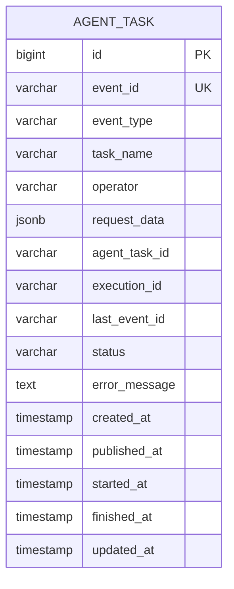

## 6.3 AGENT_TASK字段定义

| 字段 | 类型 | 约束 | 说明 |
|---|---|---|---|
| id | BIGSERIAL | PK | 数据库主键 |
| event_id | VARCHAR(128) | UNIQUE NOT NULL | Webhook.id，工作台业务关联ID |
| event_type | VARCHAR(128) | NOT NULL | 事件类型 |
| task_name | VARCHAR(256) | NOT NULL | 任务名称 |
| operator | VARCHAR(128) | NOT NULL | 任务创建人X-User-Id |
| request_data | JSONB | NOT NULL | 完整Webhook请求体 |
| agent_task_id | VARCHAR(128) | NULL | AgentSpace taskId |
| execution_id | VARCHAR(128) | NULL | AgentSpace executionId |
| last_event_id | VARCHAR(128) | NULL | 最近一次Kafka eventId |
| status | VARCHAR(32) | NOT NULL | 工作台任务状态 |
| error_message | TEXT | NULL | AgentSpace失败原因 |
| created_at | TIMESTAMP | NOT NULL | 创建时间 |
| published_at | TIMESTAMP | NULL | Webhook发布成功时间 |
| started_at | TIMESTAMP | NULL | 任务首次进入RUNNING时间 |
| finished_at | TIMESTAMP | NULL | 任务进入终态时间 |
| updated_at | TIMESTAMP | NOT NULL | 更新时间 |

## 6.4 字段关联关系

| 数据库字段 | 来源字段 | 说明 |
|---|---|---|
| event_id | Webhook.id | 工作台生成，贯穿Webhook与Kafka |
| event_type | Widget.eventType | 业务事件类型 |
| task_name | Widget.taskName | 任务名称 |
| operator | X-User-Id | 当前用户 |
| request_data | Webhook请求体 | 完整请求参数 |
| agent_task_id | Kafka.taskId | AgentSpace任务ID |
| execution_id | Kafka.executionId | AgentSpace执行ID |
| last_event_id | Kafka.eventId | 最近一次状态事件ID |
| status | Webhook结果 / Kafka.toStatus | 工作台任务状态 |
| error_message | Kafka.errorMessage | 失败原因 |

## 6.5 索引设计

### 唯一索引

```sql
CREATE UNIQUE INDEX uk_agent_task_event_id
ON agent_task(event_id);
```

### 用户任务列表索引

```sql
CREATE INDEX idx_agent_task_operator_status_created
ON agent_task(operator, status, created_at DESC);
```

### 超时任务扫描索引

```sql
CREATE INDEX idx_agent_task_status_created
ON agent_task(status, created_at);
```

### AgentSpace任务ID索引

```sql
CREATE INDEX idx_agent_task_agent_task_id
ON agent_task(agent_task_id);
```

## 6.6 数据更新规则

| 操作 | 涉及字段 |
|---|---|
| 创建任务 | event_id、event_type、task_name、operator、request_data、status、created_at |
| Webhook成功 | status、published_at、updated_at |
| Webhook明确失败 | status、updated_at |
| Kafka状态同步 | agent_task_id、execution_id、last_event_id、status、error_message、updated_at |
| 首次进入RUNNING | started_at |
| 首次进入终态 | finished_at |
| 启动超时 | status、updated_at |

## 6.7 配置项

以下配置由服务端配置管理，不单独建设业务配置表。

| 配置项 | 说明 |
|---|---|
| agentspace.webhook-url | AgentSpace Webhook地址 |
| agentspace.kafka.bootstrap-servers | Kafka Broker地址 |
| agentspace.kafka.topic | Kafka Topic |
| agentspace.kafka.consumer-group | Kafka Consumer Group |
| agentspace.task-detail-url-template | AgentSpace任务详情URL模板 |
| ai-agent.task.startup-timeout | 任务启动超时时长 |
