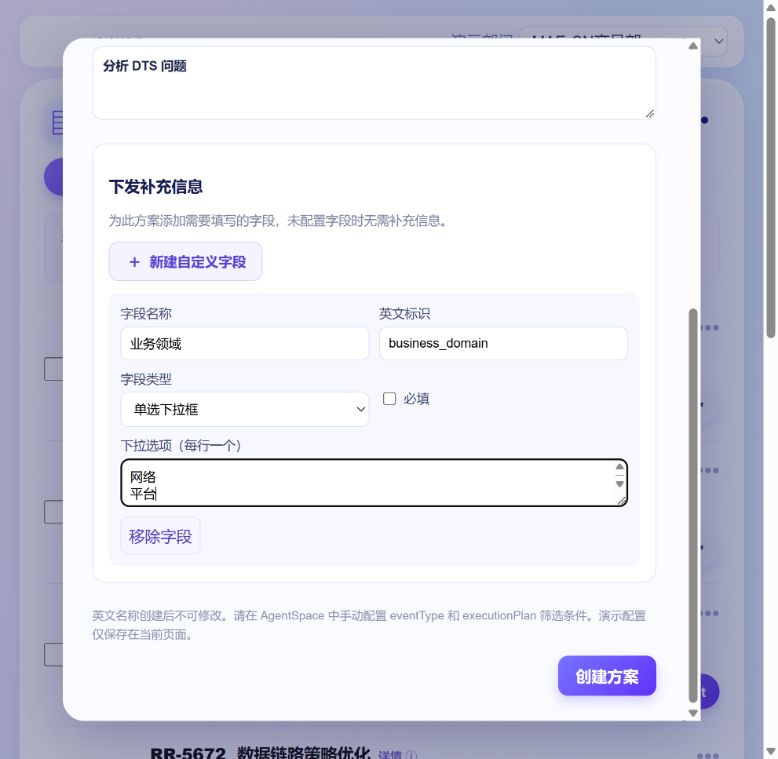
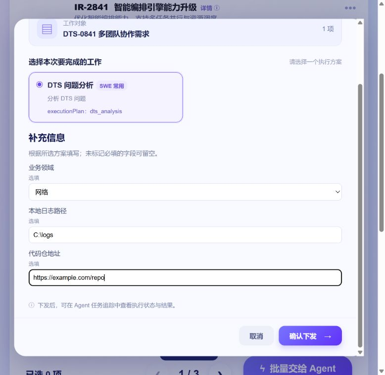
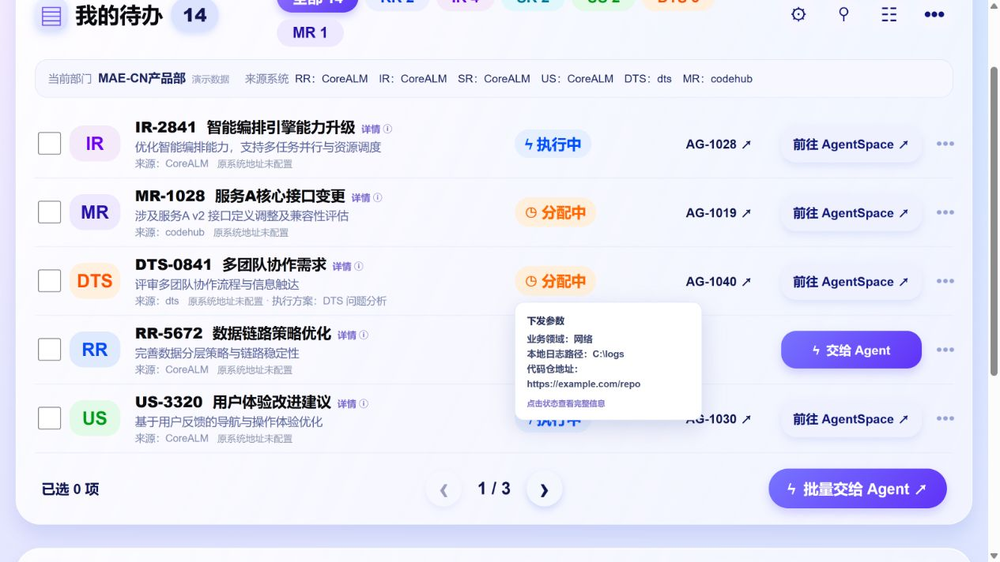
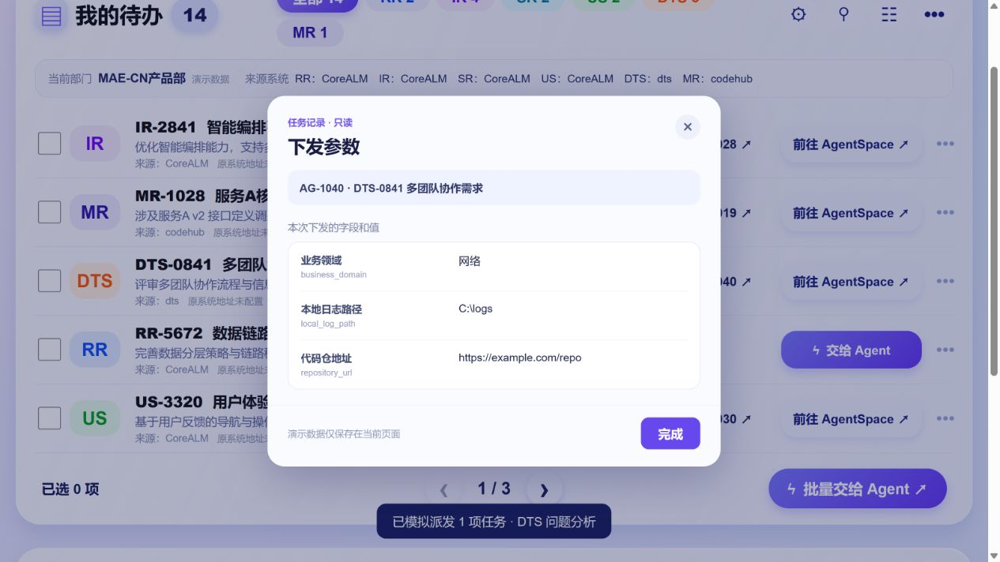

# REQ-006：执行方案补充字段需求规格

| 项目 | 内容 |
|---|---|
| 状态 | 待评审 |
| 版本 | 1.8 |
| 需求编号 | REQ-006 |
| 创建日期 | 2026-11-27 |
| 更新日期 | 2026-11-27 |
| 责任归属 | AgentSpace Widget |
| 关联材料 | [REQ-005 Widget 需求](REQ-005-2026-11-24-widget-requirements.md) |

## 背景与目标

MAE-CN 用户将 DTS 交给 Agent 时，希望提供业务领域、本机日志路径和代码仓地址。此前方案选择后直接下发；本需求允许配置者为执行方案添加字段，用户在同一个下发弹窗中选择方案并填写信息。字段由方案决定，不按部门或对象类别强制出现。

入口：我的待办 Widget 的执行方案配置；列表、详情或批量操作中的“交给 Agent”。本地体验入口：[HTTP demo](http://127.0.0.1:8000/)。

## 范围与角色

空间内有方案管理权限的用户定义各方案的补充字段；下发用户填写所选方案的字段并确认。方案的空间归属、权限、启停及基础流程沿用 REQ-005。适用于各对象类别，MAE-CN DTS 是示例场景。不提供预设快捷字段或共享字段库。

## 场景与规则

1. 配置者创建或编辑方案，点击“新建自定义字段”，填写名称、英文标识、类型及必要选项。字段支持单行文本、多行文本和单选下拉框，默认选填，可改为必填。
2. 英文标识以字母开头，仅含字母、数字和下划线；同一方案内唯一，保存后不可修改。单选选项至少一项且不重复，由配置者逐行填写。
3. 下发者选择方案后，弹窗展示该方案配置的字段。必填项为空不能确认；选填项可留空。方案没有字段时不展示补充区；没有启用方案时沿用原有下发流程。
4. 切换方案清空已填值；取消或关闭弹窗放弃输入且不创建任务。同类别批量下发共用一组值；涉及方案的混合类别沿用原规则，提示按类别分别下发。
5. 字段配置修改仅影响后续下发；已下发的参数不受后续配置修改影响。个人待办列表通过已关联任务的状态提供参数查看：悬浮或键盘聚焦时预览，点击状态打开完整参数；待办详情和 Agent 任务追踪提供独立的“查看下发参数”入口，展示该次任务的字段名称、英文标识和填写值，未填写的字段显示“未填写”；任务入口仍跳转 AgentSpace 对应任务执行页面。旧任务无快照时显示“无下发参数记录”，无配置字段的本次下发显示未配置补充字段。

## 数据与接口约定

字段值以英文标识作为业务参数随现有后台事件传递，保留 eventType 和 executionPlan 的路由语义；后台发布事件供 AgentSpace Event Task 匹配执行。后台任务台账需按每次任务保存下发时的字段名称、英文标识及值快照，并向有权查看该任务的用户提供查询；方案变更或删除不修改历史快照。业务参数在事件中的具体位置及台账接口需与后台现有契约联调确定；此处不假定已有实现。

日志路径指用户本机上目标 Host 可访问的路径。Widget 不选择 Host、不上传日志，后续 AgentSpace 流程确定使用的 Host。代码仓地址及路径由用户输入，demo 不检查其可访问性。

## 异常与边界

字段名称、标识缺失或格式错误、同方案标识重复、下拉选项为空或重复时，不允许保存方案。必填值缺失时提示并阻止下发。无字段或无启用方案不要求填写额外信息。取消操作不保存临时输入。演示身份、方案、任务及输入仅保存在当前页面内存，刷新后丢失；不代表实际系统集成。

## 验收标准

- 创建自定义字段并选择三种类型，校验名称、标识、下拉选项和必填设置；已保存字段标识不能编辑。
- MAE-CN DTS 可自行配置业务领域、日志路径、代码仓地址；选择方案后显示对应字段，必填校验正确，选填可留空。
- 列表、详情及同类别批量下发使用相同规则；切换方案或取消后输入丢弃；混合类别遵循现有处理。
- 下发后在待办列表、待办详情及任务追踪查看对应任务的参数快照，旧任务无记录时提示，方案变化不影响历史值；任务入口使用后台返回的 AgentSpace 任务地址；地址不可用时提示，不能伪造任务页面或地址。无字段及无方案场景保持原有下发。
- 后台联调验证字段值进入事件并由 AgentSpace 消费；验证不以 demo 模拟代替实际集成。

## 页面交互设计

以下均为本地 HTTP demo 的实际截图，部门为 MAE-CN；各图视口见对应说明，截图中的领域、路径和仓库均为演示数据。

### 配置字段

视口 793 × 773 CSS px：在执行方案配置中创建“业务领域”，选择单选下拉框并填写示例选项。

### 选择方案并填写

视口 793 × 773 CSS px：为 DTS 方案另建日志路径和代码仓地址字段，选择方案后在同一弹窗填写。

### 待办中的查看入口

MAE-CN，1280 × 720 CSS px：DTS-0841 模拟下发后，状态获得焦点时展示参数预览；点击状态可查看完整信息。本图使用 DTS 问题分析方案，展示业务领域、日志路径和代码仓地址的示例值。

### 查看下发参数

MAE-CN，1280 × 720 CSS px：在个人待办中点击任务状态，以字段名称、英文标识和值分行查看本次模拟下发的只读快照；待办详情和任务追踪提供相同入口，跳转 AgentSpace 的入口独立保留。

### 从 Agent 任务追踪查看

MAE-CN，847 × 773 CSS px：DTS-0841 模拟下发后，在 Agent 任务追踪的对应任务行点击“查看下发参数”。下图先展示入口位置，再展示同一任务的三个参数；此入口与跳转 AgentSpace 分开。

## 演示范围与验证

已通过本地 HTTP 验证 MAE-CN DTS：创建方案及三个自定义字段、填写下拉选项、选择方案、填写三个选填值、模拟下发；另验证待办列表、详情和任务追踪的参数查看及旧样例无记录提示。截图仅覆盖上述路径；必填、批量、方案切换、历史快照持久化、重试历史、任务跳转和其他视口尚未完成验证。JavaScript 语法及差异空白检查通过。没有新增页面运行素材；未验证真实事件、AgentSpace Host 或后台接口。

## 变更记录

| 日期 | 版本 | 内容 |
|---|---|---|
| 2026-11-27 | 1.0 | 创建独立需求，记录自定义字段配置及下发交互 |
| 2026-11-27 | 1.1 | 按需求模板补齐章节并嵌入实际交互截图 |
| 2026-11-27 | 1.2 | 修正任务入口边界，移除 Widget 内模拟参数回显 |
| 2026-11-27 | 1.3 | 增加独立下发参数查看及后台快照要求 |
| 2026-11-27 | 1.4 | 增加个人待办入口并调整参数弹窗布局 |
| 2026-11-27 | 1.5 | 强化待办参数入口可见性并补充入口截图 |
| 2026-11-27 | 1.6 | 待办状态支持悬浮预览和点击查看参数 |
| 2026-11-27 | 1.7 | 更新为包含实际示例参数的预览与详情截图 |
| 2026-11-27 | 1.8 | 补充 Agent 任务追踪入口及参数详情截图 |
