# Widget 新增功能需求规格

| 项目 | 内容 |
|---|---|
| 版本 | 1.5 |
| 更新日期 | 2026-11-24 |
| 文档性质 | 本轮完整需求文档，含业务规则、功能交互、关键截图与验收范围 |
| 状态 | 供评审 |
| 文档定位 | 当前 Widget 需求的唯一完整规格；旧分项草稿已合并删除 |

## 本轮页面变更与目标

本轮新增部门差异展示、详情内下发、空间执行方案管理及方案选择，保留原系统跳转，并采用紧凑的自适应布局。当前整理仅清理被取代的文档，未改业务页面，复用已验证的实际截图。

同一 US 的 MDE、SWE、TE 分别可能执行软件实现设计、代码实现、测试设计或执行，用户应能表达本次工作目标。Widget 通过事件传递执行方案，不直接调用 Workflow / Agent。

体验入口：[本地 HTTP demo](http://127.0.0.1:8000/)。画布顶部切换部门；待办标题打开详情，组件设置图标管理方案；对待处理事项下发并选择方案。

## 业务范围与规则

部门决定对象及来源；空间决定方案的归属、共享范围与管理权限。空间标识由工作台提供，用户无需选择。当前空间所有可访问用户均可管理方案，使用 AgentSpace 已有空间权限。

| 类别 | 公共产品开发与IT装备部 | MAE-CN产品部 |
|---|---|---|
| RR | edevops | CoreALM |
| FE | edevops | 不显示 |
| IR | 不显示 | CoreALM |
| SR | 不显示 | CoreALM |
| US | edevops | CoreALM |
| DTS | dts | dts |
| MR | codehub | codehub |

选择全部显示当前部门所有适用来源，选择单类只显示该类来源。MAE-CN 的 IR 与装备部 FE 为独立对象，不做真实数据重命名转换。

执行方案信息包括对象类别、中文展示名、英文方案名、说明和常用角色。类别仅从当前空间使用的对象中选择；英文名仅含英文字母、数字和下划线，创建后不可修改，同空间同类别内唯一。中文名、说明及角色可编辑，类别保持不变。停用方案不参与下发，可重新启用；删除需二次确认。历史任务保留创建时中文名和英文标识。

下发使用当前空间和类别的启用方案，未选择时不能确认。无启用方案时保留原有下发，不携带 executionPlan。选定方案后在统一事件顶层增加 executionPlan，值为英文方案名；保留 eventType，用户在 AgentSpace 手动配置两者联合筛选。示例结构：

```json
{
  "id": "event-001",
  "eventType": "US_ANALYSIS",
  "executionPlan": "software_design",
  "data": { "objectId": "US-3350" }
}
```

示例 eventType 仅说明结构，不定义正式事件编码。任务展示分配中、执行中、失败、已完成，不展示进度百分比；未下发待办显示待处理。模拟下发后为分配中。

## 1. Host 画布及部门首页

画布顶部仅提供演示部门选择；业务操作均在所属 Widget 内。真实用户上下文和空间标识由工作台提供，演示通过本地配置模拟。

“我的待办”展示部门、来源、类别、事项及操作。设置图标打开执行方案管理。部门差异及来源以本文上方映射表为准。当前部门和来源同排；选择单一类别时来源收敛到该类别。

装备部首页：


MAE-CN 首页使用 IR 和 SR，总数 14：

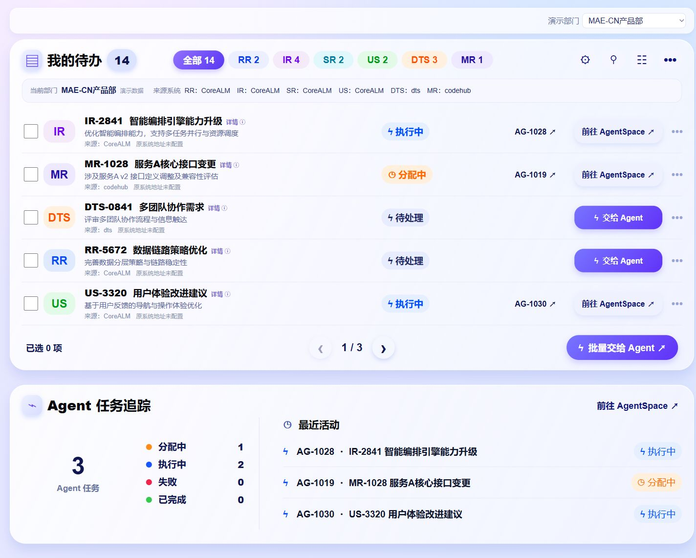

选择 US，来源只显示 CoreALM：

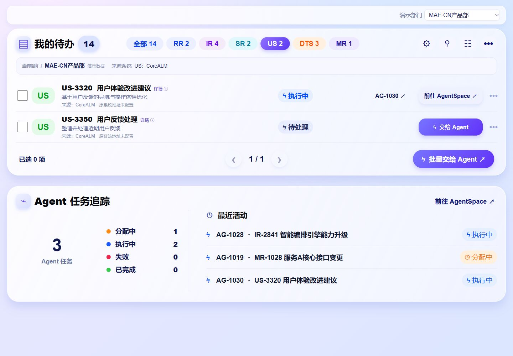

## 2. 待办预览、详情与原系统跳转

标题悬浮或键盘聚焦可预览编号、标题、描述；点击标题或更多按钮打开详情。详情支持触屏点击访问，包含工作项信息和当前适用操作。原系统跳转与 AgentSpace 任务跳转独立存在，两者分别指向业务对象和 Agent 任务。

列表及详情在存在有效源对象地址时提供原系统跳转，在新标签页打开具体对象。样例没有真实地址，因此截图显示未配置，不构造虚假链接。

用户可从详情直接点击“交给 Agent”，无需关闭后返回列表。

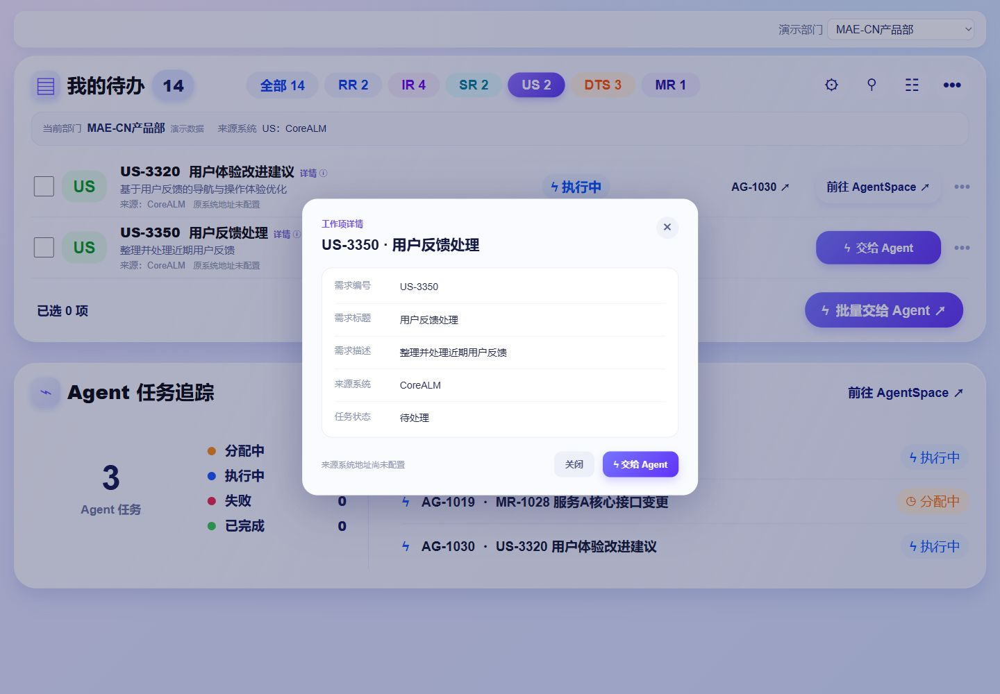

## 3. 创建与管理执行方案

从待办 Widget 的设置图标进入。当前空间自动展示，对象类别只列出该空间使用的类别。字段、唯一性、权限及生命周期按本文业务规则执行。

创建示例：US、软件实现设计、software_design、MDE，以及工作说明。不配置或拉取 Workflow / Agent 列表。

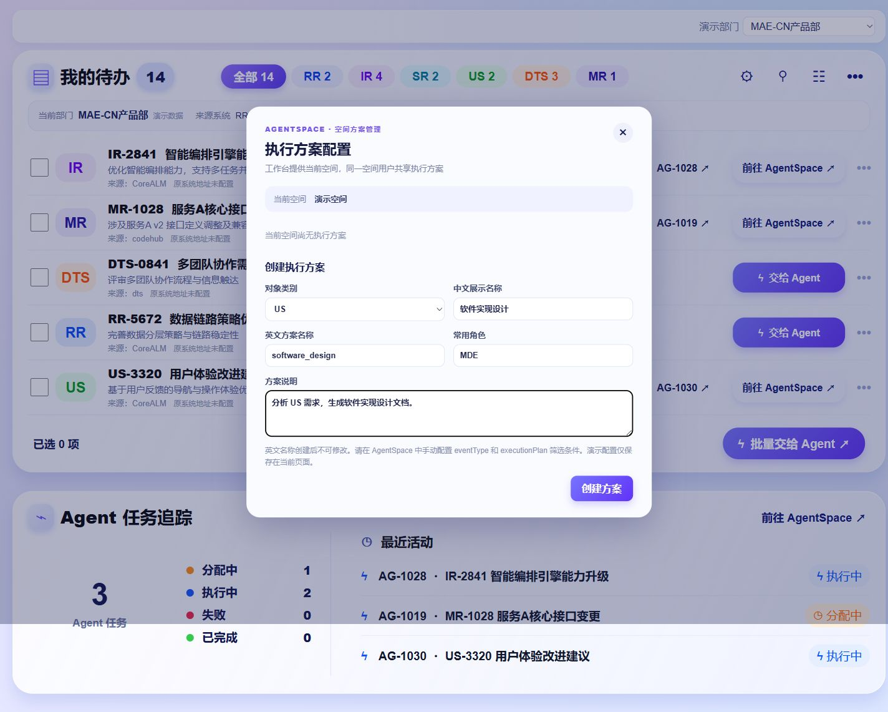

创建后显示方案及编辑、停用和删除操作：

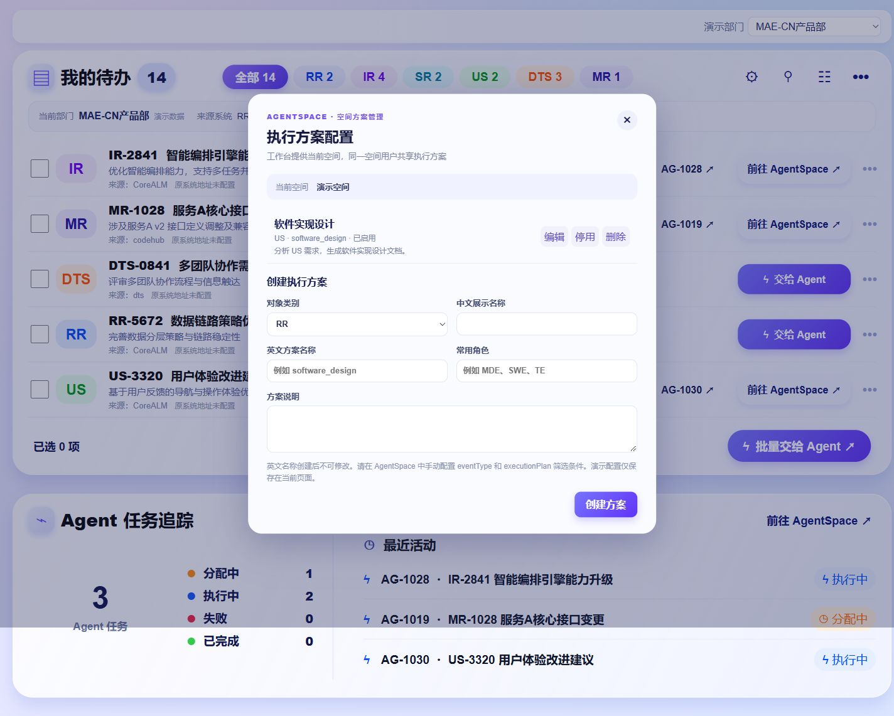

编辑时英文标识及类别锁定：

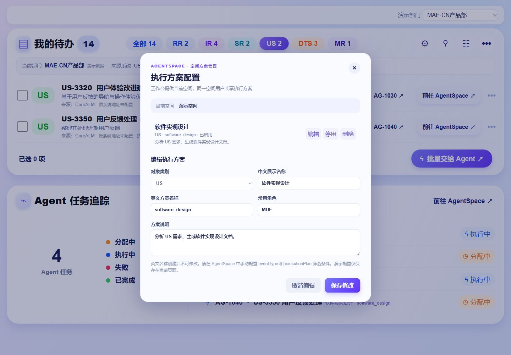

停用后显示启用操作；已经创建的任务继续显示其方案快照：

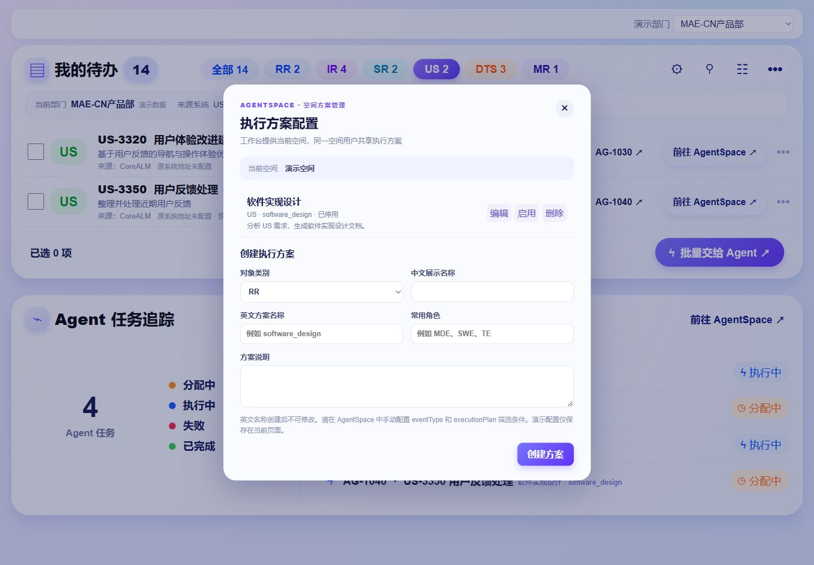

## 4. 下发选择与任务回显

详情或列表下发均进入相同流程。有启用方案时显示工作目标、说明、角色和英文标识；未选择时确认按钮禁用。无启用方案时保留原有下发流程。

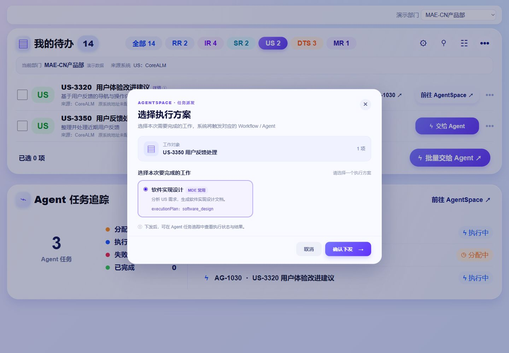

确认后显示分配中；追踪区新增任务并显示方案名称及英文标识。本图 US-3350 下发后，追踪总数为 4：

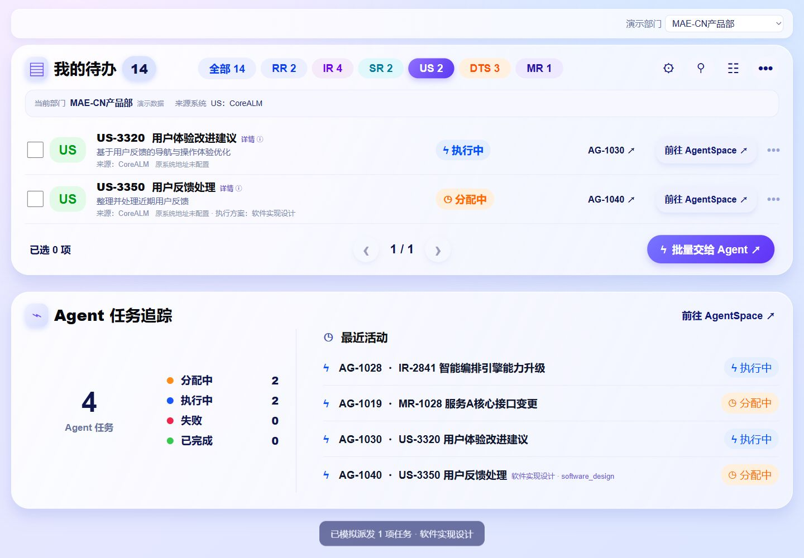

Webhook 顶层 executionPlan、eventType 联合筛选以及历史快照遵循本文业务规则。Widget 发布事件，不直接拉起执行实体。

## 5. 自适应布局

宽屏采用列式浏览，中等宽度以摘要和状态操作两层组织，手机采用紧凑摘要及操作区。检查信息密度、层级和操作可达性，不只检查无溢出。当前布局截图如下，已废弃的过渡布局不再保留。

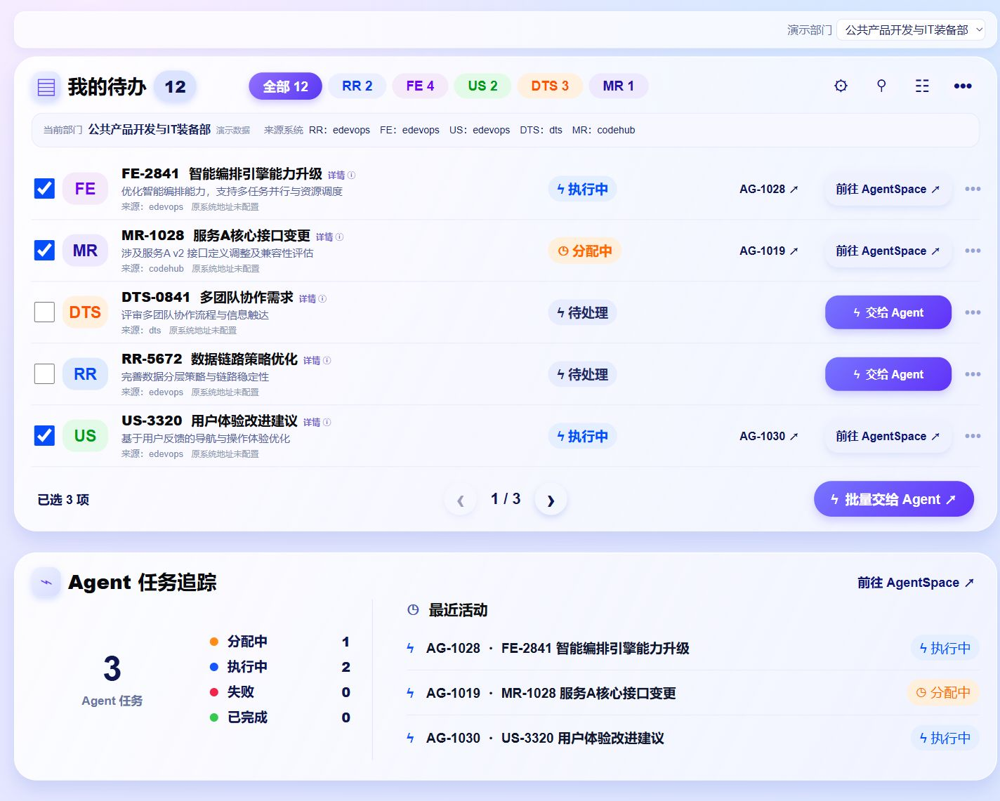

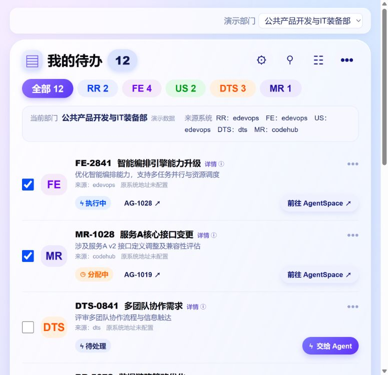

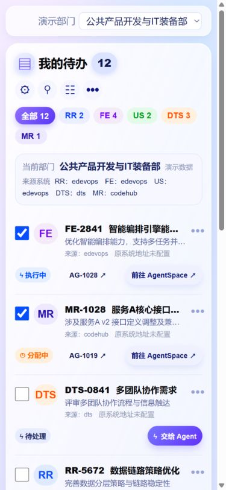

## 数据链路与操作边界

真实运行时，Widget 携带用户 Cookie 直接调用研发系统人机接口聚合待办；后台不代理、不保存研发业务数据。后台维护 Agent 任务台账、发布统一 Webhook，并消费 Kafka 更新状态；Widget 查询台账并按返回的 detailUrl 跳转。尚无 AgentSpace taskId 时不构造详情地址。原始后台设计见[输入参考](../reference/ai-workbench-backend-design-v2.md)，executionPlan 是本次扩展。

无匹配数据时显示空状态，无可下发事项时提示；演示切换部门清除选中项，但不清除当前空间方案。涉及方案的混合类别批量下发提示分别下发，不静默跳过。常用角色为展示信息，不作为强制选择或授权依据。真实失败恢复、动态参数表单和跨类别编排不在本地 demo 范围。

## 6. 实际验证及演示边界

关键交互截图使用 MAE-CN 或装备部，视口为 1440 × 1000 CSS px，完整页面截图高度可以超过视口；响应式截图为 790 和 390 CSS px。

已实际验证部门切换、方案创建、类别筛选、详情内下发、方案选择、分配中和方案回显、编辑英文标识锁定、停用状态，以及三个尺寸无页面横向溢出。已修复 MAE-CN 徽标固定为 12 的问题。

截图不表示真实业务集成或所有分支均验收通过。本轮证据不覆盖真实来源跳转、跨用户空间权限、后端 Webhook 发送、删除确认或全部失败分支。demo 使用单个模拟空间、样例和内存配置，刷新后清除。空间对象类别在 demo 中借助部门配置模拟，实际应由空间配置提供。

## 验收标准

- 部门类别和来源符合上表，筛选与总数一致。
- 列表和详情保留原对象跳转，详情内可直接下发。
- 方案创建校验、空间与类别范围、编辑限制、启停及删除规则符合要求。
- 有方案时选择后才可确认；无启用方案时沿用原有事件格式。
- 已创建任务保留方案快照并用枚举状态展示。
- 手机、中等、宽屏均检查层级、密度、图标和按钮布局，发现问题立即修复复测。

## 变更记录

| 日期 | 版本 | 内容 |
|---|---|---|
| 2026-11-24 | 1.0–1.2 | 形成交互设计并补齐实际截图 |
| 2026-11-24 | 1.3 | 归入 design，合并重复图解，规则引用统一 REQ |

| 2026-11-24 | 1.4 | 纠正为 requirements 下的完整需求规格，补齐独立阅读的业务规则与验收标准 |

| 2026-11-24 | 1.5 | 合并分项有效内容，删除已替代草稿及过渡记录，统一需求入口 |
